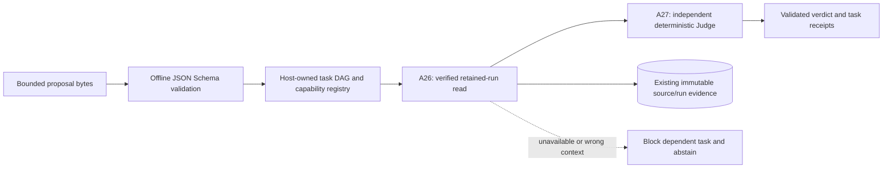
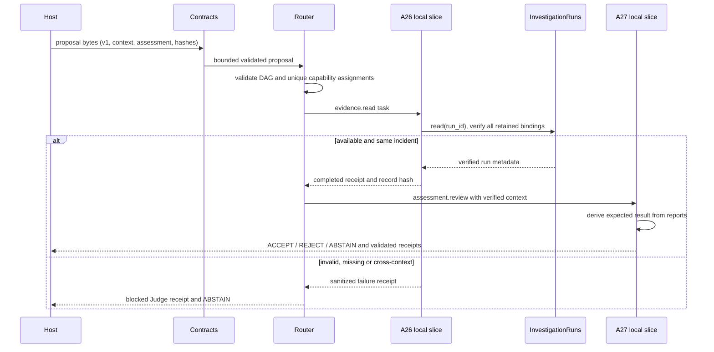

# ADR-0008 — Contract-first multi-agent integration

Status: accepted for the first local implementation slice. External deployment choices remain proposed.

## Context and decision

The retained-source investigator and durable run store work, but neither defines an interoperable multi-agent execution boundary. Preserve their semantics and database schema. Add a separate coordination package with versioned JSON Schema contracts, host-owned capability routing, a bounded task DAG and an independent deterministic Judge over verified retained runs. These are local capability slices of A26 and A27, not completed autonomous agents. Preserve the 36-role Turkish design catalog as the original reference.

Do not claim that an internal message envelope implements MCP or A2A. Protocol adapters must translate negotiated external messages into this boundary after authentication and authorization; adapters must not accept caller-provided tool policy, worker registrations, endpoint URLs or credentials. No external listener or provider is enabled in this increment.

## Module and six-layer boundaries

Layer 1 (integration): future MCP/A2A/transport adapters terminate protocol and identity, then validate internal messages. Layer 2 (workflow): durable reservations, dependency/retry/cancellation and execution leases remain the next infrastructure increment. The present local DAG is an in-process scheduling primitive only. Layer 3 (orchestration): routing maps exact capability and controlled tags to one enabled worker; ambiguous or missing routes reject. Layer 4 (specialists): A26 reads an integrity-verified retained run and A27 independently checks a structured assessment against evidence. Layer 5 (evidence): the existing IncidentStore and InvestigationRuns own immutable source/run/artifact records. Layer 6 (governance): deterministic policy, schema, integrity and Judge gates precede optional advisory model review and human remediation approval. These are implementation responsibilities, not a replacement of the original six-layer archive.

## Ten component decisions

### 1. MCP — planned adapter

Target the MCP 2026-07-28 specification after interoperability tests, not a home-grown wire protocol. Its stateless core and per-request capability negotiation differ from older stateful examples. A host-configured client may translate only allowlisted tool descriptors into the existing ToolGateway catalog. Discovery and annotations are untrusted. Pin SDK/protocol versions at adapter implementation time; bound responses, deadlines and egress. OAuth resource/audience checks are mandatory for remote HTTP. Tokens for the MCP server must never be passed to upstream services. No MCP adapter or SDK is running yet. Sources: [specification](https://modelcontextprotocol.io/specification/2026-07-28), [authorization](https://modelcontextprotocol.io/specification/2026-07-28/basic/authorization/security-considerations).

### 2. A2A — planned adapter, internal contracts implemented

Plan against released A2A 1.0.0, with wire version 1.0 and explicit version handling. Agent Cards advertise only tested capabilities and supported security schemes; discovery is not authorization. Translate messages, context/task IDs, task states and artifact references to internal contracts. Get/Cancel/stream support must be advertised only when actually implemented. Terminal tasks cannot resume; redelivery must be deduplicated by durable request identity. Internal task/receipt v1 contracts exist now; they are not A2A protocol objects. Source: [A2A specification](https://a2a-protocol.org/latest/specification/) (version reviewed 2026-11-10).

### 3. LLM — planned provider boundary

A host-owned model router selects only preapproved model/version/data-residency profiles by capability, structured-output support and budget. Version prompts, policy and output schemas separately and bind their hashes to eventual runs. Route failures only to profiles with equal or stronger data and tool restrictions. Reserve token/cost budgets before dispatch; count with the provider tokenizer, bound input/output and redact logs. Retrieval documents and model text cannot change policy or execute tools. No provider, model fallback or token optimization is implemented or measured yet; do not equate simulated specialists with LLM agents.

### 4. RAG — planned retrieval boundary

Retrieve authorized incident/runbook chunks after tenant/source ACL filtering, with immutable document/version/chunk hashes and provenance. Treat retrieved instructions as data. Bound top-k/context tokens; return an explicit insufficient-evidence outcome rather than fabricate support. Evaluate retrieval recall, evidence relevance and poisoning cases on separate development/held-out families before enabling generation. The current retained-run read is evidence hydration, not vector search. Vector store and embedding deployment are undecided; no data has been uploaded.

### 5. CAG — planned context cache

Cache only eligible authorized context. Keys must include tenant, principal authorization scope and policy epoch, model/tokenizer, prompt/schema version, source content hash and retrieval parameters. Apply TTL/size budgets, revocation/invalidation and encrypted storage; distinguish an absent entry from a cached negative result. Never cache credentials, tool grants or Judge decisions as permanent authorization. Provider prompt caching and application context caching require separate accounting. No distributed or model-context cache runs now. The small schema-validator process cache is unrelated to CAG.

### 6. Contracts — implemented

Packaged JSON Schema Draft 2020-12 task, proposal, verdict and receipt documents are the runtime source of truth, validated by jsonschema 4.26.0. Reject additional/missing fields, duplicate JSON keys, nonfinite values, invalid UTF-8, unknown versions and messages over 16,384 bytes. Task graphs have at most eight nodes, bounded unique dependencies and exact shared incident/run context. Schema resolution is offline; no caller schema or remote references are loaded. All outbound messages are validated too. State/result/reason combinations are constrained. See [contract reference](../contracts/coordination-v1.md).

### 7. Certificates and Zero Trust — planned deployment gate

The local Python host and store file owner remain trusted; role labels and content hashes are not cryptographic identity. Before any remote adapter, enforce TLS 1.3 and mutual certificate verification, chain/expiry/EKU checks and an explicit service-identity authorization mapping; prefer managed short-lived workload certificates over checked-in keys. SPIFFE/SPIRE is a candidate, with URI SAN identity checks performed by a maintained integration rather than a custom certificate parser. Signed tokens require algorithm/issuer/audience/expiry/nonce validation, rotation and revocation; token exchange may only narrow delegation. No certificates, JWT verifier, issuer or mTLS service is provisioned in this increment. Expired/unknown-issuer/wrong-audience/replayed credentials must be integration tests before remote enablement. Source: [SPIFFE X.509 SVID](https://spiffe.io/docs/latest/spiffe-specs/x509-svid/).

### 8. TAG — implemented controlled capability routing

Use explicit capabilities evidence.read and assessment.review with controlled semantic tags. An immutable host registry enables only the A26/A27 local slices. Tags request capability; they do not grant permission. Exactly one candidate must match the capability and every required tag. Reject ambiguous matches, unknown dependencies, cross-context graphs, self-dependencies and cycles before execution. Stable topological order and a ready-set primitive support later scheduler work. Dynamic registration or embedding-based routing remains disabled.

### 9. Connections and transport — local execution implemented, remote planned

The current two-worker path is synchronous and in-process with bounded metadata messages. A failed evidence dependency blocks Judge execution and returns a sanitized abstention. There is no remote transport, durable message acknowledgment, lease, replay protection or latency/SLA claim. Next implement durable reservations, bounded retries/backoff, cancellation and crash recovery. Then introduce one authenticated A2A HTTP+JSON binding and MCP client transport. Add gRPC/streaming or a queue only when measured volume and delivery requirements justify them; require backpressure, message limits, deadlines, correlation and at-least-once deduplication. Do not advertise exactly-once external effects.

### 10. Judge — deterministic gate implemented, LLM review planned

A27 independently derives the scoped assessment from retained source and reconciliation values, validates ordered tool/report references and declared impact, and compares the proposed assessment and exact evidence set. ACCEPT requires agreement; contradictions or unsupported citations REJECT; unavailable/incomplete/inconsistent evidence ABSTAINS. A26 obtains the run through InvestigationRuns.read, preserving existing integrity checks. The Judge cannot repair data or change host grants. A separate future LLM-as-a-Judge provider may return advisory rubric results, with its own model/prompt/version, blinded fixtures and expert adjudication; it may never override schema, policy, evidence or deterministic rejection. Model agreement is not calibrated truth.

## Implemented data flow and security boundary

## Compatibility, measurement and next gate

No database migration, artifact rewrite or investigator change is required. Existing source/run replay fingerprints remain unchanged by this package. Review results are returned to the operator, not persisted as durable workflow jobs or signed approvals. The original architecture and old repositories remain untouched.

Increment 07 records measured scenario, line and branch coverage; coverage does not establish production security or model accuracy. This increment plans all ten components and implements contracts, TAG, local transport/dependency failure behavior and a deterministic Judge. Remote protocols, certificates, models, RAG and CAG remain explicitly unimplemented. Before choosing cloud/identity/model/vector/broker services, obtain the operator's deployment/data-residency/cost decision; no approval is needed for continued local reservations/retry/cancellation infrastructure.
