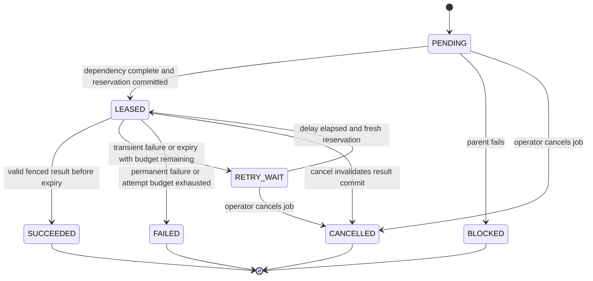
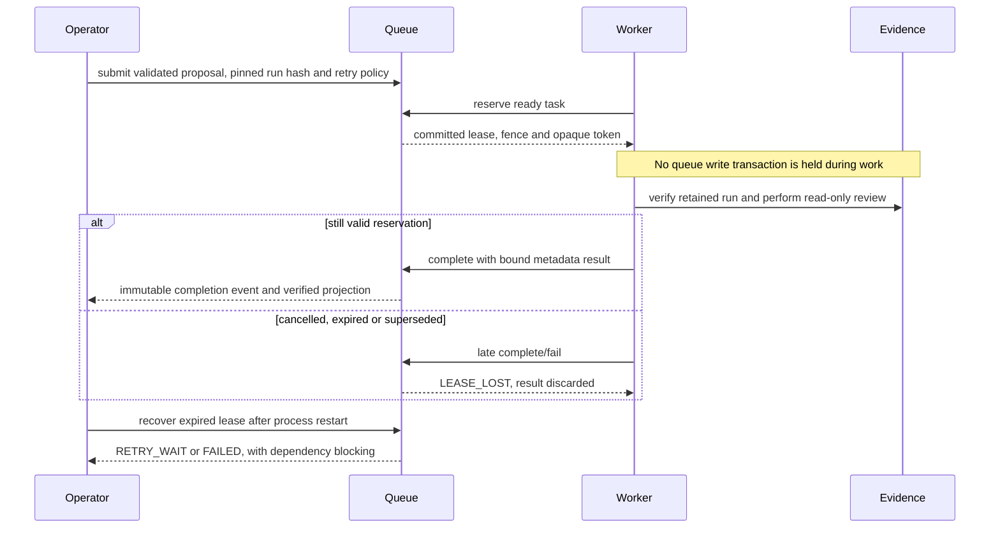

# ADR-0009 — Durable local review execution

Status: accepted. Adds a durable option to ADR-0008's immediate read-only review; external deployment remains gated.

## Problem and decision

The A26→A27 review path returned ephemeral task receipts. A process exit lost scheduling state; there was no lease, bounded retry or cancellation fence. Add a separate local ReviewQueue database and worker API for exactly this two-task graph: collect a verified retained-run pointer, then Judge the proposed assessment. Preserve IncidentStore/InvestigationRuns schemas, source/run records and their replay fingerprints. The immediate review command remains available.

The queue owns execution state. The evidence store owns immutable source/run data. A26 and A27 remain bounded deterministic role slices, with no network listener, LLM or remote agent identity. The worker reads evidence outside queue write transactions. No background worker/daemon or external broker is provisioned.

## Persistence and integrity

queue-init explicitly creates a private 0600 SQLite file and refuses any existing path. Queue application ID/schema differ from evidence stores; opening an evidence database as a queue fails closed. No implicit creation, adoption or migration occurs. jobs stores immutable versioned request manifests; events stores immutable revisioned state snapshots with a SHA-256 chain; projections is a mutable scheduling index verified against the latest event. Reads validate manifests, graph/context bindings, bounded task states, checksums and history/projection agreement. These controls detect corruption; they are not signatures or protection against a malicious file owner who can rewrite every byte and checksum.

Each mutation uses BEGIN IMMEDIATE, foreign keys, synchronous=FULL, a five-second lock wait and explicit rollback on failure. Evidence reads and Judge work occur after reservation commit and before a separate fenced result commit. This avoids holding the queue write lock during work. SQLite admits one writer at a time; no distributed-database or high-throughput guarantee is claimed. Queue connections open existing files in rw mode even for logical reads so SQLite can recover a hot rollback journal after process failure; this does not create missing files or append application events. A process-exit test forces dirty page spill to verify actual journal recovery, beyond an unflushed transaction test. References: [SQLite transactions](https://www.sqlite.org/lang_transaction.html), [rollback journal recovery](https://www.sqlite.org/lockingv3.html).

## Idempotency, dependencies and state

Submission validates a closed proposal against an existing verified run and pins its metadata checksum. The host constructs the A26→A27 graph. A request key is unique within the queue: equivalent proposal evidence order is normalized; the same request/record checksum/retry policy returns the original job, including terminal jobs. Changed request data conflicts. A duplicate never reopens cancelled/completed work; submit a new key for an intentional rerun. Workflow implementation fingerprints are retained separately so an idempotent retry preserves the original job rather than silently upgrading it.

Only PENDING or eligible RETRY_WAIT tasks whose dependencies succeeded can reserve. Judge cannot start before collect succeeds. A terminal collect failure marks Judge BLOCKED. A terminal job is never dispatched again. Job SUCCEEDED means the review process completed, not that a proposal was accepted: inspect tasks.judge.result.decision (ACCEPT/REJECT/ABSTAIN). An inconclusive source investigation produces a completed Judge task with ABSTAIN, not fabricated approval.

## Leases, retries and cancellation

A reservation increments a persisted fence/attempt counter and returns a random token whose hash alone is stored. Raw tokens are excluded from repr, public queue output and history. owner is a bounded local label, not authenticated identity. Complete/fail/renew requires matching task state, fence, owner and token, and now strictly before lease expiry. Duplicate, stale, replaced or cancelled reservations cannot commit. Expiry at the exact boundary rejects completion, even before explicit recovery.

Leases are 1–60,000 ms (default 30,000). The host API permits at most three renewals per attempt; work-once does not automatically heartbeat. A long read can finish after expiry but its result is discarded. Recovery and reservation scans turn expired leases into RETRY_WAIT or terminal failure; recovery is idempotent. Transient evidence-store SQLITE_BUSY/SQLITE_LOCKED and lease expiry are retryable. Integrity/version/context failures, missing/inaccessible evidence and unexpected internal failures are terminal and sanitized. Queue lock contention before a reservation returns an explicit database error; it is not silently treated as a successful dispatch.

Retry policy is host-owned: 1–5 attempts per task (default 3), base delay 1–60,000 ms (default 1,000), capped exponential delay up to 3,600,000 ms (default cap 60,000). Backoff begins when the failure/expiry is recorded, so repeated recovery cannot skip the delay. The local policy is deterministic; multi-host jitter/circuit-breaker behavior remains future transport work.

Cancellation atomically marks outstanding tasks CANCELLED and invalidates active reservations. Completed tasks remain unchanged. Repeating cancellation is idempotent; already SUCCEEDED/FAILED jobs reject cancellation. In a terminal completion/cancellation race, the first committed terminal result wins. Cancellation does not forcibly interrupt Python/SQLite reads, undo completed work or promise preemption of future external effects.

## Bounds, clock and version contract

The queue admits at most 128 active jobs; each has exactly two tasks, at most five attempts per task, at most three renewals per attempt, at most 128 immutable events, and 32,768-byte manifest/projection budgets. Events have a small fixed envelope allowance. Terminal history is retained without automatic deletion; disk quotas/retention administration remain future operator features. This is a bounded local research scheduler, not a distributed message service.

Scheduling uses trusted host UTC epoch milliseconds so deadlines survive restart. Backward time movement relative to the job's last write rejects mutation; forward jumps may expire leases. Clock synchronization/monitoring is a deployment requirement. No hard real-time guarantees are claimed.

Jobs pin worker, queue, coordination, evidence-validation and SQL code hashes plus Python/SQLite/jsonschema versions. A mismatch fails execution closed while historical reads remain available. Drain/pause workers before code upgrades and preserve the matching environment for pending jobs; intentional reruns use new keys after operator review. The current implementation makes no network/model call and uses no persistent secret credentials.

## Delivery and recovery semantics

Task work is at-least-once after a crash/expiry; a fenced reservation can commit at most one result. This is not exactly-once external execution. Both current handlers are read-only, so repeated work is safe. Before side-effecting tools or remote agents, enforce downstream idempotency keys, an outbox/inbox and explicit external cancellation semantics.

The existing evidence store retains its read-only open behavior. If an evidence writer crashed after dirty page spill, run store-recover --db with writers stopped before reopening it through that API. This explicit command opens only an existing file, permits SQLite hot-journal rollback, validates the known schema and SQLite quick_check, and preserves committed evidence and replay fingerprints. It does not repair corrupted committed evidence or bypass normal checksum validation.

Use SQLite backup with evidence writers and queue workers stopped. Preserve both the referenced evidence store and queue, restore to private files, validate retained bindings and recover expired leases. Do not run an original queue and a restored clone concurrently: fencing is local to one database and does not coordinate cloned files or hosts. Do not put databases, journals, tokens or backups in Git.

## Next gate

Document identity/egress policy and implement one authenticated protocol adapter with ephemeral certificate and negative authorization tests before external connectivity. Deployment/data-residency/identity-provider choices must precede provisioning. Generic multi-agent remote graphs, durable network delivery, provider routing, RAG/CAG, advisory LLM Judge, held-out model evaluation and UI remain planned. No model accuracy metric is introduced by scheduler test coverage.

