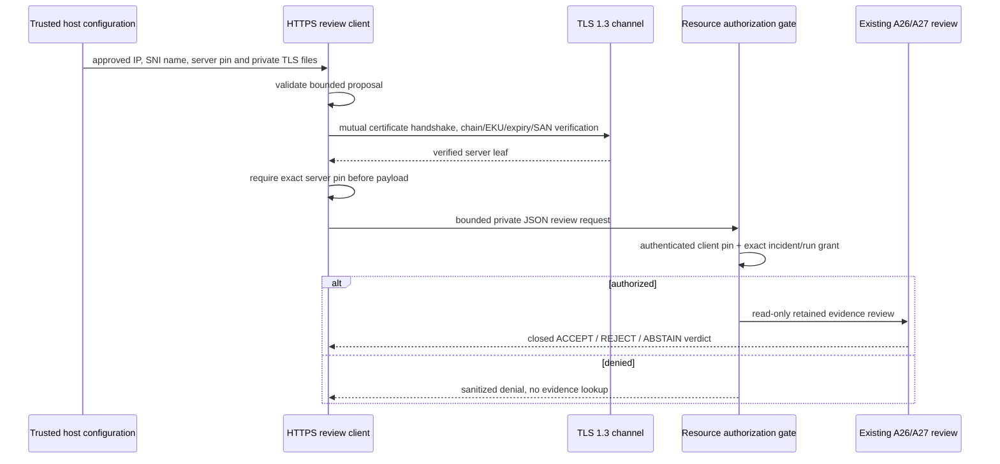

# ADR-0010 — Mutual TLS, resource authorization and pinned egress

Status: accepted for the integration boundary. No production listener or external service is provisioned.

## Problem and decision

The existing queue and coordination layers deliberately trust their local Python host. A role label, checksum or queue lease is not remote identity. Before attaching MCP/A2A adapters, implement a small transport-independent certificate/policy boundary and a bounded private read-only HTTPS review binding. Preserve source/run/queue schemas and execution fingerprints.

This increment implements actual mutual TLS and exact certificate/resource authorization. It does not implement a production HTTP server, full Zero Trust platform, OAuth/JWT exchange, SPIFFE issuer, A2A or MCP interoperability. Protocol adapters must later use their normative generated models and keep these deterministic controls. A private JSON binding is not advertised as an A2A implementation. See the [A2A 1.0 normative data model requirement](https://a2a-protocol.org/v1.0.0/specification/).

## Modules and trust ownership

security.mtls builds client/server SSLContext objects from host-selected CA/certificate/key paths and extracts verified peer leaf fingerprints from actual SSLSocket instances. security.policy owns immutable resource grants and egress configuration. integration.secure_review maps an already authenticated proposal to the existing read-only A26→A27 review and exposes an HTTPS client. Local CLI/queue behavior remains trusted-host only; the network binding does not expose queue mutation or tool-grant administration.

The application host and its configuration/SSLContext remain trusted. Neither forwarded certificate headers nor caller-supplied role names/policies/endpoints can establish identity. A host integrating handle_review must supply the actual verified TLS socket; a plain reverse-proxy identity header is rejected. Production proxy termination needs a separate attestation design before enablement.

## TLS and certificate identity

Both directions require TLS 1.3, CERT_REQUIRED, strict X.509 verification and explicit CA material. Client hostname verification requires SANs; common-name fallback is disabled. ALPN advertises HTTP/1.1. OpenSSL performs certificate chain, validity, signature and endpoint-purpose/EKU checks; this project does not write a custom X.509 validator. A configured CA bundle is loaded without a call to discover default roots, and an exact leaf pin is additionally required in both directions. The host's OpenSSL/trust configuration remains part of the trusted environment. Reference: [Python ssl](https://docs.python.org/3.11/library/ssl.html).

The outgoing client checks the server leaf fingerprint after TLS verification and before sending proposal bytes. The receiving gate checks the authenticated client leaf against a host grant for the exact incident_id/run_id. Sharing a CA does not confer resource access. Default policy grants nothing. Grant input is bounded (at most 1,024 immutable entries), canonical resource identifiers and lowercase SHA-256 pins only. Permissions are specific to this read-only review operation, not generic tools or arbitrary agent execution.

Pins intentionally bind a certificate instance. Rotation requires an explicit overlap/new-pin policy update and eventual removal of the old grant. No automatic identity enrollment, CRL/OCSP service, certificate issuer or continuous revocation distribution is provided. Removing a grant denies subsequent requests, but does not undo a completed read. Managed short-lived issuance, coordinated rotation, revocation and tenant/workload identity mapping remain deployment gates.

TLSFiles hides local paths from repr. POSIX private-key files must exclude group/other permissions; no material is committed. Encrypted keys without a secret provider reject instead of prompting interactively. Production operators must supply private files through an approved secret mechanism; this increment generates certificates only in temporary test directories. Test generation uses separately installed cryptography 50.0.2; production code uses Python ssl/OpenSSL and adds no runtime dependency.

## Egress and message boundary

The host configures one named service, port, literal IP address, server leaf pin and path. There is no URL from a model/request, DNS lookup, environment proxy, redirect, alternate endpoint, credential forwarding or automatic retry. TCP connects to the approved literal address; SNI/hostname verification still uses the configured service name, avoiding DNS rebinding between authorization and connect.

Unspecified, multicast, link-local/metadata, reserved and IPv4-mapped destinations are rejected. Loopback is denied unless the trusted host explicitly enables the local test profile. Private service IPs may be explicitly configured for an internal deployment; incoming messages cannot change that choice. The path accepts a restricted origin-form alphabet and rejects traversal, query/fragment and authority forms. This is a single configured trust domain/store, not a multi-tenant gateway.

The client validates the closed proposal before opening a socket. The receiver authorizes before evidence lookup, then returns only the closed verdict contract. It neither rewrites evidence nor creates durable jobs. A valid review may REJECT/ABSTAIN. Response run_id must match the request; server-authenticated verdicts remain scoped evidence assessments, not calibrated model confidence.

## Network bounds and resource lifetime

One request uses one TLS connection, then closes it. Proposal/verdict bodies retain the 16,384-byte contract limit; response headers plus body share a 32,768-byte receive budget. Require exactly one bounded Content-Length, JSON media type and status 200. Reject redirects, transfer/content encodings, truncated responses, oversized headers/bodies and invalid/cross-run verdicts.

A shared monotonic network deadline covers TCP connect, TLS handshake, HTTP writes and every underlying receive (default five seconds, host-configurable >0 to ten seconds). Slow trickles do not reset the deadline. File loading and bounded local validation are outside this network deadline; socket timeouts do not claim OS-level CPU preemption. The HTTP parser receives a borrowed TLS channel so closing its HTTP handle cannot invalidate a fragmented response body; the enclosing exchange closes reader/connection/socket resources on success and failure. Errors expose constant sanitized messages, not certificate paths, raw rows or underlying exception text.

## Validation and compatibility

Actual loopback TLS integration tests cover accepted and denied reviews, expired/untrusted/wrong-EKU certificates, missing client certificates, hostname/SAN failures, TLS downgrade, wrong pins, same-CA unknown identities, rotation and cross-resource denial before reads. Hostile response tests cover redirects, framing, truncation, byte budgets, fragmented bodies and trickled headers. Fault injection supplements handshakes for missing certificate extraction and sanitized configuration/network failures. A test-only HTTP server is not shipped as a production listener.

Installed-package checks run outside the source checkout with temporary certificates and test acceptance/denial without modifying evidence. CI tests Python 3.11/3.12/3.14, enforces new package coverage and audits runtime plus test dependencies from pyproject.toml. Full-history/PDF secret scans remain enabled. Public repository visibility was confirmed and the current licensing documentation updated; no visibility/settings change is performed by this PR. Historical architecture/repositories and committed evidence are preserved.

## Next gate

Implement a version-pinned official MCP/A2A adapter using generated normative models over the verified identity/egress boundary, with interoperability tests before advertising protocol support. Choose deployment identity/issuer, data residency, secret delivery and production HTTP hosting before provisioning. Add authenticated audit/rate controls, revocation/rotation operations and tenant isolation before external exposure. OAuth/token exchange and model/RAG/CAG providers remain separately gated. No model call or accuracy metric is introduced.
