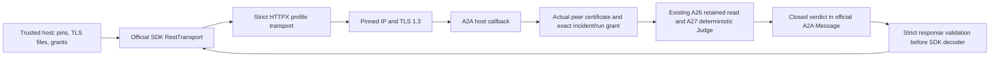

# ADR-0011 — Official A2A 1.0 stateless retained-review profile

Status: accepted for a bounded client and TLS-aware host callback; production hosting remains gated.

## Decision

Add one optional protocol adapter before exposing new remote capabilities. Use the official Python `a2a-sdk==1.3.0` and its generated `lf.a2a.v1` protobuf models, with A2A 1.0 HTTP+JSON serialization. Keep deterministic evidence/Judge, local queue contracts and persisted execution fingerprints unchanged. Base installation continues to require only the existing JSON Schema dependency; importing the optional integration modules requires the `a2a` extra.

Implement a synchronous consultation: one proposal-v1 JSON data part in a user Message, one verdict-v1 data part in an agent Message. The context is the existing incident; the proposal/verdict identifies the retained run. The normative protocol permits direct Message responses for stateless exchanges, while recommending Tasks/Artifacts for task-oriented outputs. This profile deliberately provides no remote task lifecycle, durable delivery or general A2A server conformance claim. A subsequent production host must address error mapping, admission/rate controls and lifecycle requirements before broader task support.

References: [A2A 1.0 specification](https://a2a-protocol.org/v1.0.0/specification/), [official Python SDK](https://github.com/a2aproject/a2a-python), [pinned distribution](https://pypi.org/project/a2a-sdk/1.3.0/). Do not silently enable the SDK's 0.3 compatibility surface.

## Module boundaries and flow

`integration.a2a_profile` owns official-model encoding, strict raw JSON/profile validation, host-generated Agent Card metadata and the TLS-aware callback. `integration.a2a_client` calls the actual SDK RestTransport through an isolated HTTPX transport. `integration.secure_review.post_json` owns the existing bounded mTLS exchange. `security.policy` permits the exact `/message:send` path in addition to the existing restricted path alphabet. It does not permit arbitrary colon paths or caller-defined endpoints.

The generated Agent Card advertises one read-only skill, HTTP+JSON 1.0 and mutual TLS. It exposes neither leaf pins nor connection IPs/credentials. It is constructed from host configuration and is not fetched, hosted publicly or used to authorize resources. Public/extended discovery, tenants, metadata/extensions, files/URLs, text prompts, push, streaming, Tasks and task administration are outside this profile.

## Strict parsing and security

The SDK's REST compatibility decoder can be lenient. Validate raw response bytes before allowing that decoder to run. Reject unknown fields, protobuf aliases, numeric roles, duplicate JSON keys, nonfinite numbers, invalid UTF-8, oversized or deeply malformed input and all unsupported profile shapes. Decode with the official generated protobuf model and retain the closed business schemas. Require canonical UUID message/context identifiers, correct roles, one JSON data part and the proposal/verdict run binding. No request can carry a tool policy, TLS identity, alternate endpoint or additional metadata.

Require exactly one request `A2A-Version: 1.0` and JSON media type. A response version header is optional under this binding; if present it must be exactly 1.0. The client accepts only the configured HTTPS origin and exact path, strips unforwarded headers and rejects credential/identity forwarding. No DNS, environment proxy, discovery, redirect, alternate service, protocol downgrade or retry is introduced. Access is checked against the actual verified TLS peer and exact resources before reading retained evidence. Authorization remains independent of A2A roles/Agent Cards.

The 16 KiB body and 32 KiB total received-byte budgets remain. An async deadline covers request collection and the exchange; the remaining budget is passed to the synchronous network deadline. Caller cancellation propagates. A running thread cannot be forcibly preempted: its socket operations retain that deadline and close their resources; bounded local certificate loading/validation is not OS-level CPU preemption. No remote cancellation or exactly-once claim is made for this stateless read-only operation.

## Validation and compatibility

Tests exercise generated model round trips, actual official RestTransport calls over temporary mTLS, accepted/rejected assessments and citations, denied/cross-context calls before evidence reads, strict-before-lenient response handling, header/version/path controls, cancellation, byte/deadline limits and sanitized failures. Existing certificate/framing tests remain active. A new installed-wheel check runs outside the source checkout and confirms acceptance, Judge rejection, default denial and unchanged evidence bytes.

CI installs `[test,a2a]` on Python 3.11/3.12/3.14, retains 100% coordination/workflow/security/integration coverage gates, and audits runtime plus every optional dependency group. Source/run/queue schemas, original Turkish architecture/PDF and the old repository remain unchanged. See [profile contract](../contracts/a2a-review-v1.md) and [delivery evidence](../delivery/increment-10.md).

## Next gates

Next add one official MCP read-only tool adapter behind the existing tool gateway, with version-pinned SDK/schema and negative-access/interoperability tests. Before external provisioning: production HTTP framing/error mapping, workload issuer and managed private-key delivery, revocation/rotation operations, authenticated audit/rate controls, tenant boundaries, data residency and lifecycle/idempotency decisions. Model routing, RAG/CAG and advisory LLM Judge require separate bounded contracts and held-out evaluation. No external service or model is enabled by this increment.
