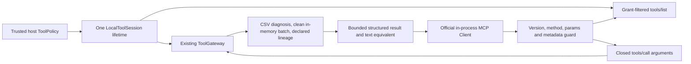

# ADR-0012 — Official MCP adapter over the local tool gateway

Status: accepted for trusted in-process use. Remote transport and authentication remain separate gates.

## Decision and ownership

Use the official `mcp==2.3.0` optional dependency and its native Server/Client/models. Pin the profile to protocol revision `2026-07-28`; explicit legacy versions reject. `LocalToolSession` owns one existing `ToolGateway`, one immutable host ToolPolicy, generated input schemas and an official SDK Server. New client connections share that instance's budget/deadline; only the trusted host can create a new policy lifetime. Never create a session per tool call or treat client metadata as permission.

The SDK's in-process client dispatches directly to the server. This proves typed SDK discovery/call interoperability, not HTTP wire framing, stdio process isolation or remote MCP conformance. The existing A2A mTLS path remains separate; this increment makes no claim that MCP calls inherit certificate authentication. Do not expose this Server remotely before implementing authenticated admission, request/body limits, quotas, rate/audit controls and approved transport configuration.

Sources: [official SDK 2.3.0](https://pypi.org/project/mcp/2.3.0/), [in-process client testing](https://py.sdk.modelcontextprotocol.io/get-started/testing/), [2026-07-28 tool specification](https://modelcontextprotocol.io/specification/2026-07-28/server/tools).

## Flow and boundaries

Expose only usable exact tool/dataset grants. CSV tools accept source_orders; lineage accepts only host-granted datasets. Listings are stable, sorted, detached from internal schemas and private with zero cache lifetime. Tool annotations describe read-only/closed-world behavior; enforcement comes from schemas and gateway grants. Batch execution uses the clean packaged transform and exports no snapshots. No arbitrary SQL/path/URL/policy, fault transform, external resource, prompt, sampling, task or multi-round input operation is registered.

A middleware guard precedes SDK parameter handling, rejects unsupported operations/versions/fields and bounds JSON-serializable params. SDK-required client/version metadata is allowed but grants no authority. Optional custom metadata, cursors, task and continuation fields reject. The Server's default OpenTelemetry middleware is replaced with the profile guard; no exporter or server payload tracing is configured. A host instrumenting its own client remains responsible for its telemetry policy.

## Validation, resource accounting and failures

Input schemas use exact properties, required types, grant-derived dataset enums and bounded CSV length. The gateway additionally enforces UTF-8 bytes, exact grants, atomic call reservations and its shared deadline. Rejected arguments consume no dispatch budget; admitted tool failures consume a call. Missing/invalid CSV, quality FAIL and batch BLOCKED remain distinct outcomes: quality failure is a valid tool result, while execution/policy failure sets MCP isError.

The result envelope is closed: outcome plus object/null report, with report present only on OK. Nested reports use the existing deterministic tool implementations; this increment does not introduce per-report JSON Schemas. Text and structured content describe the same result. Invalid/nonfinite/unencodable/oversized output is replaced by a constant OUTPUT_REJECTED result; raw snapshot artifacts are omitted. See [profile contract](../contracts/mcp-local-tools-v1.md) for exact budgets.

Execution checkpoints for cancellation before dispatch. Synchronous local tools are bounded by existing input limits and cooperative before/after deadlines, not hard preemption; they may block the event loop while executing. The in-process path already holds Python objects before the byte check; it does not provide network ingress/memory protection against an untrusted process. These limits must be addressed by a separate production transport/worker design before exposure.

## Compatibility and next increment

Base dependencies, source/run/queue schemas, durable execution fingerprints and original architecture/PDF remain unchanged. CI installs test/A2A/MCP extras, verifies installed packages outside the source checkout, enforces critical package coverage and audits all optional graphs. Tests cover actual SDK calls, default denial, dataset isolation, bad data, metadata/version rejection, concurrent/reconnected budgets, cancellation and output bounds. No external service, model call or accuracy result is introduced.

Next build a versioned evaluation contract and frozen held-out baseline separate from development fixtures: split/data leakage rules, scenario-family metrics, confidence/abstention calibration requirements, cost/latency budgets and regression acceptance gates. Then add a provider-neutral model adapter and advisory Judge under those gates. Production protocol hosting and identity/audit/tenant operations remain prerequisites for external deployment; UI follows stable authenticated APIs and measured evaluation.
