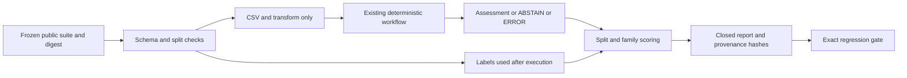

# ADR-0013 — Versioned public validation before model integration

Status: accepted for a deterministic synthetic baseline. No model/provider is enabled.

## Decision

Establish versioned suite/prediction/report contracts, split leakage checks, denominator-explicit scoring and a frozen public baseline before model integration. Preserve the existing evaluation function, source/run/queue schemas and persisted execution fingerprints.

The suite retains the original ten development cases and adds eight validation cases in four curated families: quoted records, combined violations, normalization collisions and quoted/unicode transform loss. Groups and family labels cannot cross splits. A conservative normalized content signature rejects reordered/trimmed near copies. Family labels are curated categories, not proof of independent failure mechanisms. The new cases were authored and inspected during development: they are public synthetic validation, not a blind holdout, production distribution or evidence of unseen-fault generalization.

## Contracts and execution boundary

The closed suite schema fixes version/visibility and bounds cases/text. Duplicate JSON keys, nonfinite values, invalid Unicode, duplicate IDs, missing splits and cross-split group/family/content overlap reject before execution. Packaged bytes are pinned by a reviewed SHA-256 file and tested against the fixture copy. Dataset changes require a new reviewed version, not a silently regenerated pin. A hash detects drift; it is not a signature against someone able to edit both files.

The runner projects only CSV and transform into the existing workflow. Labels, expected tools, split/group/family do not reach execution. Scoring runs afterward with exactly one prediction per case. Results retain suite/scorer and existing workflow/policy hashes, with no raw CSV, incident IDs or exception text. Temporary stores are cleaned up. Same-runtime runs are repeatable; Python/SQLite changes can change implementation fingerprints.

The report is validated against its own closed schema. Exported JSON Schemas in docs/contracts are equality-tested against runtime definitions. Report validation checks envelope shape; the scorer derives authoritative arithmetic rather than trusting externally asserted metrics.

## Metrics and acceptance

Each split/family reports correct labels, abstentions, execution errors, coverage, unconditional exact match and selective accuracy. The complete 3-by-5 confusion matrix includes ABSTAIN/ERROR columns. Per-class support/TP/FP/FN and precision/recall/F1 are explicit; class FN includes abstentions/errors. Binary failure detection separately counts wrong healthy/failure decisions and failure-case abstentions/errors. Undefined denominators are null. Tool-sequence matching is independent of label correctness.

The deterministic regression gate requires every label and tool sequence to match in both splits. This fails any abstention/error. It is a fixture regression rule, not a model deployment threshold. No confidence calibration, statistical interval, token/cost, model latency or production accuracy is measured. Eight correlated synthetic cases do not justify such claims.

## Validation and next gates

Tests include label isolation, intentionally wrong predictions, false positives/negatives, all-abstain/all-error cases, null denominators, sequence mismatch, schema/digest drift, split leakage, malformed inputs and installed repeatability. CI requires 100% statement/branch coverage for scorer, runner and report; the CLI is additionally exercised in subprocess/installed checks.

Next define provider-neutral prediction/evidence contracts and a sealed evaluation process before live calls. Agree model/provider, data residency and cost constraints; establish acceptance thresholds before inspecting independently curated held-out results. Record model/prompt versions and bounded token/latency/cost, abstention/fallback and citation checks. Tune on development/validation; retire any holdout used for tuning. Provider/LLM Judge/RAG/CAG and production transport/identity/UI remain separately gated.
