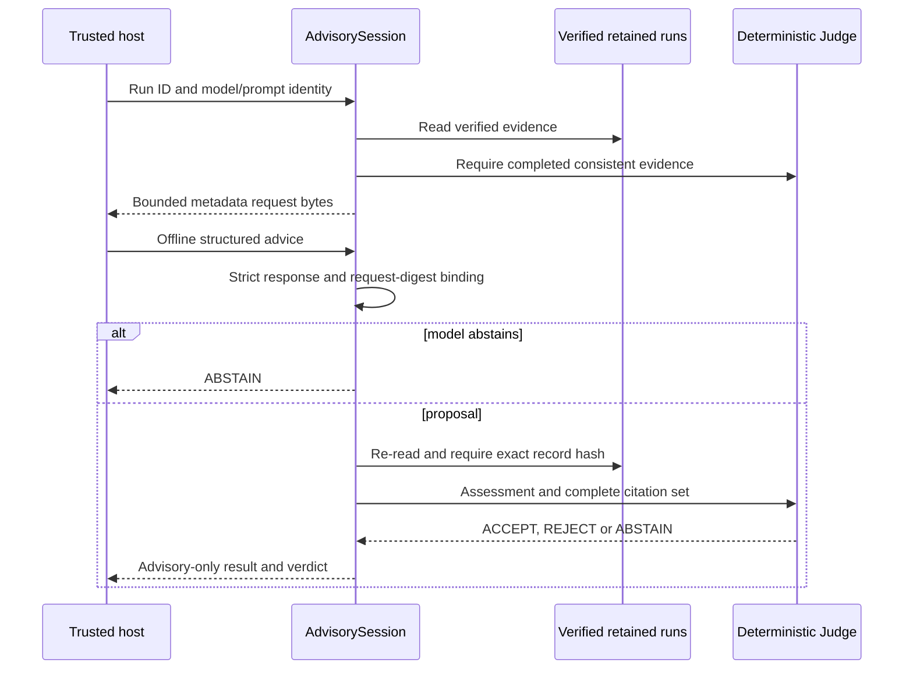

# ADR-0014 — Provider-neutral offline advisory boundary

Status: accepted for host-owned metadata/response contracts. No model provider or execution authority enabled.

## Decision and flow

Before adding a provider adapter, freeze closed metadata and response contracts in advisory/contracts.py, with exported equality-tested JSON Schemas. A trusted host creates AdvisorySession from InvestigationRuns, a run ID and host-selected model/prompt identifiers. The run is read and its completed evidence checked by the existing deterministic Judge. The request contains a fresh request ID, incident/run IDs, exact record and prompt hashes, model identifier and evidence digests. It contains no raw source data, expected assessment, prompt text or API credential.

This is a metadata envelope, not a complete generation prompt: hashes alone do not provide semantic evidence to a model. Context selection/redaction, prompt assembly, provider transport, authentication and accounting require later contracts. No provider is invoked here.

## Input and output enforcement

The response has only version, request_sha256, decision, assessment and evidence_sha256. PROPOSE requires a known assessment and nonempty unique citations; ABSTAIN requires null assessment and no citations. Unknown fields, free rationale, confidence claims, tool calls, policies, URLs and credential fields reject. The request digest binds the whole request, including random request ID, model/prompt identity and record hash. It is correlation, not a signature or remote identity. The host must retain the session; never recreate it from a model-provided request.

Both directions use a 16,384-byte UTF-8 limit, duplicate-key and nonfinite rejection, strict types, UUID/hash formats and sanitized errors. The existing Judge requires the exact retained citation set and derives the assessment from evidence; model assertions cannot override it. Unavailable/changed records abstain. A MODEL_ABSTAIN response does not re-read evidence. Matching citations do not prove arbitrary prose or root-cause claims, so no such fields are admitted.

Results are fixed-shape advisory-only dictionaries containing a request digest, status, constant reason and the existing closed deterministic verdict where applicable. VERIFIED_ADVISORY means a matching scoped assessment, not approval to execute, causal truth or calibrated model accuracy. This code neither persists jobs nor invokes tools, changes data, grants access or schedules remediation. Repeated review of a response is permitted; there is no durable exactly-once or replay ledger claim.

## Scope and next gates

Tests cover matching/contradictory advice, partial/fabricated citations, stale and cross-session responses, explicit abstention, missing/changed records, forbidden fields, malformed JSON/Unicode/nonfinite values, duplicate references and installed read-only behavior. Existing persisted fingerprints/schemas are unchanged.

Next implement bounded evidence-context selection/redaction, prompt assembly/versioning, provider-neutral usage/timeout/cost admission, predeclared acceptance rules and a separately curated sealed evaluation process before live calls. Model/provider, data residency and spending decisions precede activation. The [agent map](../agents/README.md) distinguishes working slices, current snapshots and future observer requirements. Production identity, remote MCP hosting, quotas/audit/tenant operations and UI remain gated.
