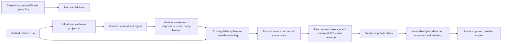

# ADR-0015 — Allowlisted evidence context and versioned prompt preparation

Status: accepted for offline preparation; provider/accounting and deployment gates remain pending.

## Decision

Build a bounded semantic evidence context before a provider adapter. The prior AdvisorySession remains a metadata-only correlation/gate API. PreparedAdvisory adds context selection and two-message prompt assembly around that session, with no network/model call, tool execution or evidence mutation.

Use host-owned ContextPolicy byte limits, a fixed English system instruction and an explicit context version. Projection accepts only known source/reconciliation/declared-impact summaries. It emits fixed status/check/dataset labels, row/finding counts, truncation state, reconciliation pass/fail flags and evidence digests. Unknown tools/checks or invalid types reject. Raw CSV, snapshots, SQL, customer/order values, column names, report messages, record locators, financial totals and expected/actual reconciliation values are omitted. Expected benchmark labels and trace.assessment are never projected.

This is data minimization for the current diagnostic contracts, not a general PII detector or anonymity proof. Counts, operational incident/run IDs and content hashes still carry information; hashes can be linkable/dictionary-guessable. Provider/data-residency approval remains required before any external transfer. Future tools require a reviewed projection/schema change instead of forwarding unknown report fields.

## Preparation and provenance

The prompt identity hashes context version, static system text, context digest, response-schema digest and policy. It is passed as the existing request prompt_sha256. The unique request digest also binds model identity, request ID and retained record hash. The complete canonical message array receives a separate input_sha256 including the unique metadata. A record change between projection and session preparation rejects rather than mixing evidence revisions. Response handling continues through the existing exact-record/citation/deterministic Judge gate.

The prompt instructs the model to treat evidence as data, abstain when insufficient, cite the full known evidence set and avoid causal/action claims. Prompt wording is defense in depth, not an isolation guarantee. Structural privacy comes from projection, and authority restrictions come from strict response schemas and deterministic verification. Untrusted column/message/source strings are never inserted into the prompt.

## Limits and mutability

Default context budget is 8,192 UTF-8 bytes; default complete canonical message-array budget is 32,768 bytes. Host ranges are 256–16,384 and 256–65,536 respectively; bool/noninteger/out-of-range values reject. Limit checks are inclusive and do not silently truncate required context. Existing truncated diagnostic findings retain their explicit flag. A prompt can be rejected even if its context fits because metadata, schema and instructions also count.

Internal message/manifest snapshots are immutable bytes and accessors decode detached objects. Mutating returned objects cannot alter the prepared snapshot or identity. The manifest records actual context/prompt bytes and hashes, but no token count, billable cost or latency estimate. These application-byte limits exclude future provider-specific serialization/framing. A provider adapter must dispatch the exact approved snapshot, record provider/model/prompt versions, enforce token/cost/deadline controls and validate accounting separately. Repeated preparation/read-only review is allowed; no durable call quota or exactly-once claim is made.

## Validation and compatibility

Tests exercise clean/source-failure/transform-loss projections, monetary/identifier exclusion, hostile header omission, truncation flags, unknown tool/check rejection, wrong types, exact budget boundaries, immutable host policy, record races, schema/system/policy identity changes, detached output mutation and cross-session rejection. All 18 public benchmark cases prepare and pass the existing scoped deterministic review using offline expected responses; this tests integration, not model accuracy.

No base dependency, persisted evidence/queue schema, execution fingerprint, original architecture archive or agent scheduling behavior changes. CI's existing advisory coverage gate includes this module, with installed-package validation outside checkout.

## Next gate

Implement provider-neutral usage reservation/accounting, token/cost/time admission and controlled retry/fallback rules, followed by approved provider integration and independently curated sealed evaluation. Actual tokenization/billing is provider-specific and cannot be inferred from UTF-8 bytes. Live model usage, calibration, causal inference, production identity/operations and UI remain gated.
