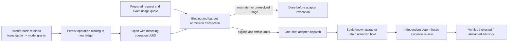

# ADR-0021: Bind a dedicated usage ledger to one approved operation

Status: accepted as the second local B07 slice.

## Problem and decision

A shared budget alone cannot prevent a host routing mistake from mixing unrelated investigation results or selecting an unapproved model. Persist an immutable operation contract when initializing a new, separate usage ledger. The contract binds an opaque operation UUID, incident and run UUIDs, retained record hash, complete evidence hash set, prompt/context/schema hashes, explicit model allowlist and absolute deadline.

Opening a bound ledger requires its operation UUID. Reservation verifies the prepared request against the binding inside the admission transaction, before returning an idempotent receipt or recording usage. A model change is permitted only within the allowlist and the same bound evidence/context. Each prepared request still receives its own request hash and its own exact input quote. Usage and Judge checks remain independent: eligible does not mean correct.

The ledger uses metadata version 2 and requires `max_total_attempts`. Unbound version 1 ledgers remain readable without rewriting. No implicit migration, rebind or initialization over an existing database is allowed. Version 1 readers reject version 2; current readers reject a version/column mismatch. Attempt tables and evidence databases are unchanged.

## Flow

## Trust boundaries and limitations

The UUID is an identity check, not a credential or cryptographic signature. The database and Python host remain trusted local components. File permissions, global operation-to-ledger uniqueness, account-wide quotas and protection against a privileged process replacing metadata are outside this slice. Creating another ledger is a new host authorization, not a model capability. Bindings contain operational identifiers and evidence hashes; they are not public telemetry. Raw source, prompt text and credentials are not stored in the binding.

No provider transport, automatic cross-model fallback, durable routing result history or recovery/reconciliation is introduced. A version 2 database must be explicitly opened by compatible software; keep historical version 1 ledgers intact. Rollback means using compatible readers for bound ledgers, never downgrading metadata.

## Validation and quality interpretation

Adversarial tests cover each identity field, changed context policy, another run or incident, unknown usage, concurrent connections, restart, malformed stored contracts, schema downgrade, deadlines, allowlists and pre-receipt admission. Integration tests prove an unauthorized adapter is never invoked and an eligible but incorrect advisory is still rejected. Installed-wheel checks exercise successful bound review and denied model switching.

Passing these tests establishes behavior for the tested cases. It is not a model accuracy percentage. Before live activation, measure task accuracy, precision/recall, false positive/negative rates, abstention and failure coverage on independently labeled, sealed data, with predeclared acceptance thresholds and scenario-level reporting. The current public synthetic benchmark is not a sealed holdout.
