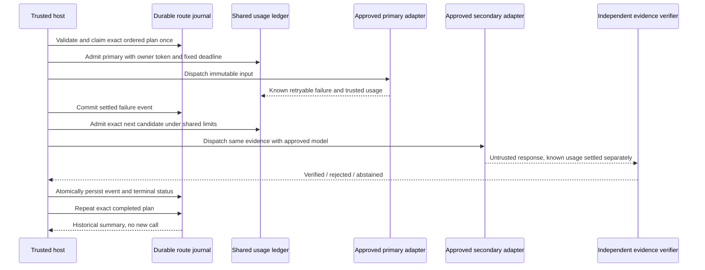

# ADR-0022: Bounded ordered model failover with durable outcomes

Status: accepted for the local B07 routing profile. Live providers remain gated.

## Problem and decision

Operation bindings establish eligible models and evidence, but an explicit host loop could lose its progress after a crash or switch models after a quality rejection. Introduce an ordered route of one to eight unique approved models and a single-owner journal in the same SQLite database as usage admission. Prevalidate every candidate's binding, immutable input, exact quote and adapter revision before claiming the route.

Create a new version 3 ledger with `initialize_usage(..., operation=binding, routing=True)`. This opts into exclusive route admission; ordinary dispatch without the route ownership token is denied. Existing version 1 and 2 databases remain unchanged and usable in their original profiles. There is no automatic migration or downgrade. Readers validate the routing table/version relationship; older software must not open version 3 data.

The plan binds the operation hash and the ordered model/request/input/quote hashes. One atomic claim owns the entire route. Before each reservation, the ledger checks the ownership token and exact next candidate. An already completed candidate cannot be resent through its accounting receipt. The next candidate is authorized only after a durable settled `KNOWN_RETRYABLE_FAILURE` event. One attempt per model; no nested same-model retry or loop back.

## Decision table

| Outcome | Action |
| --- | --- |
| Known retryable technical failure with settled usage | Persist event; try the next approved model if limits permit |
| All approved candidates return known retryable failure | Finish `EXHAUSTED` |
| Verified, rejected or abstained advisory | Finish with that review status; never seek a different Judge verdict |
| Invalid response or known terminal failure | Stop |
| Unknown usage | Retain the reservation and stop |
| Deadline or admission denial | Stop; preserve all accounting |
| Cancellation, invalid clock or journal write failure | Leave `RUNNING` for audited recovery; never auto-resume |
| Exact completed plan replay | Return an explicitly historical summary without another adapter invocation |
| Concurrent or restarted unfinished claim, or changed plan | Reject without dispatch |

## Data flow

## Crash, concurrency and clock boundaries

Usage and route events share one database, but no database transaction spans a provider call. There is an intentional gap between usage settlement and journal recording. Failure in that gap leaves a claimed `RUNNING` route, even if usage was settled; it cannot be automatically resumed. Event insertion and its final status update commit together. A failure of either rolls both back. Cancellation after dispatch retains unknown usage. No lease expiry, automatic refund, resend or reconciliation is inferred from elapsed time.

The controller checks both absolute time and a finite, nondecreasing monotonic clock across the whole route. A deadline reached after a result can override its final route status even when the event records a verified review. All candidates use the original bound deadline and shared token, cost and attempt limits. Synchronous adapters must cooperate; this does not preempt blocking Python or enforce remote cancellation.

## Security and quality boundaries

The host, adapter code and local database are trusted. The ownership token coordinates local calls; it is not a network identity or certificate. The plan and journal contain operational model IDs, hashes and attempt UUIDs, not prompts, responses, source rows or credentials. They still require private host storage. No global operation registry, multi-tenant authorization, cryptographic journal attestation or production provider is introduced.

Replay is an archival record, explicitly marked `replayed`; it is not current evidence verification or execution approval. Independent review still validates each new response. The public synthetic benchmark and unit suite measure tested behavior, not real model accuracy. Live activation still requires independently labeled sealed evaluation, declared accuracy/precision/recall/abstention thresholds, provider-specific token/rate accounting and data handling approval.

## Validation

Twenty-six routing tests cover upfront validation, exact-plan replay/conflicts, incorrect and abstained output, unknown usage, shared budgets/deadlines, concurrent hosts, cancellation, crash windows, real SQLite rollback, model order/token checks and version compatibility. The installed demo performs an actual local automatic primary-to-secondary switch, historical replay without resend and direct-dispatch denial. No network model calls occur.
