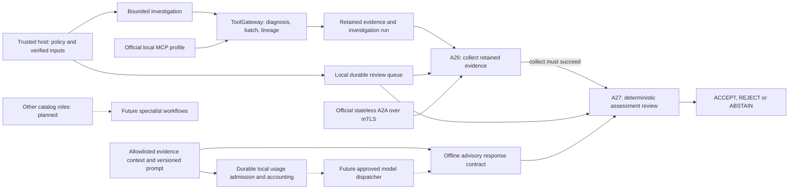
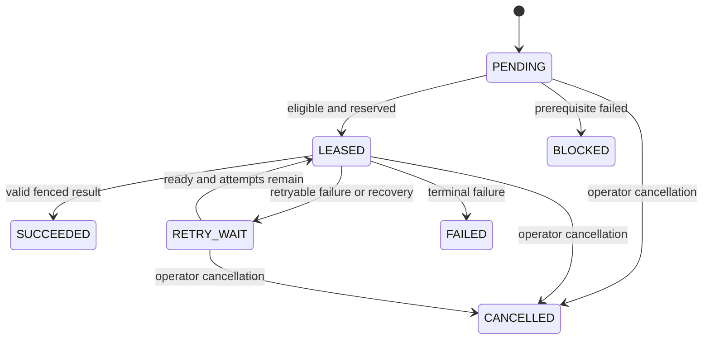

# Agent connections and execution visibility

This page is a rendered connection map of implemented capabilities, not a live dashboard. GitHub renders the Mermaid diagrams below. The [36-role catalog](../agent-catalog.json) and original architecture remain the planned specialist design. Only A26 retained evidence read and A27 deterministic verification are currently executable role slices. MCP tools and the investigation workflow are software components, not additional autonomous agents. No LLM worker is active.

## Implemented connections



The immediate review runs A26 then A27 in one process. The durable queue reserves task `collect` for A26; only after collect succeeds may task `judge` execute under A27. Retry/lease conditions still apply. A26 failure blocks its dependent judge task. Job success means the workflow executed successfully: its Judge verdict can still REJECT the proposed assessment.

## What can be inspected today

For an existing local job, use the installed CLI with the actual queue path and returned job ID:

```sh
python -m aegisflow_dr read-job --queue work/queue.db --job JOB_ID
```

This returns a verified snapshot and recorded event history; it is not a continuously refreshed display. Inspect task states under `tasks.collect` and `tasks.judge`, attempts, lease expiry and event kinds. A LEASED state is a worker reservation, not proof that a process is currently computing. A read can perform SQLite pager recovery on a hot journal; it does not schedule or dispatch tasks. Existing CLI tests cover this command.



The diagram summarizes task states; queue code is authoritative for individual transitions and terminal/race handling. Raw job snapshots and IDs belong to the authorized local operator; do not publish real operational records or use the CLI as a remote authentication boundary.

## Future live observer

After infrastructure/API gates, add an authenticated read-only observer showing: active/reserved agent, waiting dependencies, next eligible tasks, attempts/backoff, lease/heartbeat freshness, completed/failed/cancelled tasks and evidence/verdict links. Use task/job IDs and recorded state transitions, with reconnect cursors and periodic snapshot reconciliation. Mark stale snapshots and distinguish scheduled, leased and actually running states. Parallel graphs can have several eligible next agents, so the view must not promise a single global sequence.

The observer must project allowlisted metadata rather than expose raw database rows, prompts, source snapshots, credentials or lease tokens. Tenant/resource access, audit controls, retention and heartbeat/event transport remain design gates. No web UI, event stream or continuous worker heartbeat service is implemented in this increment.
