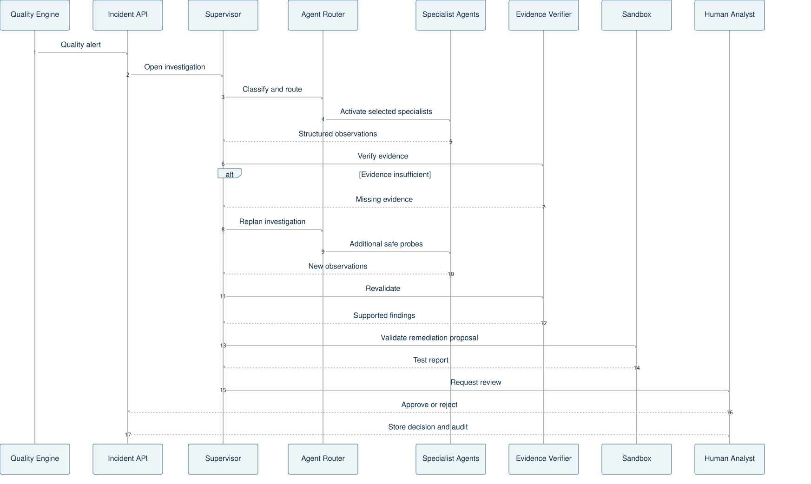

# AegisFlow AI — Agentic Data Reliability

Kurumsal Yazılım Mimari Tasarımı · 6 Katman · 36 Uzman Ajan · Bitirme Projesi ve İME Geliştirme Planı

AegisFlow AI'ın uzmanlık alanını artık netleştirebiliriz:

ETL/ELT veri hatlarında meydana gelen veri kalitesi ve işlem hatalarını tespit eden, kök nedenlerini çok ajanlı yapay zekâ ile araştıran, çözüm planı hazırlayan ve önerilen düzeltmeleri güvenli bir test ortamında doğrulayan Agentic AI platformu.

Bu tasarımda başlangıçtan itibaren 36 uzman ajan rolü tanımlayacağız. Sistem, gelen problemin türüne göre yalnızca ilgili uzmanları etkinleştirecek. Bir olay için 5 ajan yeterliyken başka bir olay 15 farklı uzmanlık gerektirebilir.

Ancak 36 rolün tamamı ayrı LLM veya mikroservis olmayacak. Bu ayrımı doğru kurmak, projenin gerçekten geliştirilebilir olmasının en önemli koşullarından biri.

## 1. Projenin kesin kapsamı

AegisFlow AI — Ürün tanımı

Ana problem

Veri hattı güvenilirliği

Yapay zekâ yaklaşımı

Multi-Agent + Agentic AI

Mimari

6 mantıksal katman

Ajan kataloğu

36 uzman rolü

İlk veri ortamı

SQL + Python + CSV

Kurumsal hedef

Salt okunur pilot entegrasyon

### Sistem neleri yapacak?

Veri hatlarının çalışmasını, veri kalitesini ve şema değişikliklerini izleyecek.

Anormal durumları tespit edip yapılandırılmış olay kayıtları oluşturacak.

Sorunun türünü değerlendirerek uygun uzman ajanları seçecek.

Logları, veri profillerini, SQL dönüşümlerini ve veri bağımlılıklarını araştıracak.

Kök neden hipotezlerini gerçek kanıtlarla sınayacak.

Düzeltme önerileri ve gerekiyorsa kod değişikliği taslakları hazırlayacak.

Önerileri izole ortamda test edecek.

İnsan onayı için teknik vaka dosyası oluşturacak.

İlk sürümde üretim veritabanında otomatik değişiklik yapmayacağız. Böylece hem akademik deneyler tekrarlanabilir olacak hem de güvenlik açısından kontrollü bir mimari elde edeceğiz.

# 2. Altı katmanlı yazılım mimarisi

Bu projede 6 ana katman yeterli. Ayrı bir "RAG Layer", "Memory Layer" veya "Graph Layer" oluşturmaya gerek yok; bunları ait oldukları katmanların alt bileşenleri olarak tasarlayacağız.

AegisFlow AI — Logical Architecture

01

Presentation & Investigation Layer

Kullanıcı arayüzü · Pipeline Explorer · Incident Workspace

React · TypeScript · React Flow

02

Data Integration & Observability Layer

Kaynaklar · Loglar · Pipeline çalışmaları · Metadata

PostgreSQL · CSV · OpenLineage

03

Data Quality & Diagnostic Intelligence Layer

Kalite kontrolleri · Lineage · RCA araçları

Python · SQL · dbt · GX

04

Agentic AI & Orchestration Layer

Supervisor · Dinamik routing · 36 ajan kataloğu

LangGraph · LLM · Tool Registry

05

Evidence, Remediation & Workflow Layer

Kanıt · Hipotez · Sandbox testleri · İnsan onayı

Evidence Store · Git Diff · HITL

06

Security, AgentOps & Infrastructure Layer

RBAC · Audit · Trace · Benchmark · Dağıtım

Docker · OpenTelemetry · CI/CD

Katmanlar mantıksal sorumlulukları belirtir. Gerçek veri ve kontrol akışları çift yönlüdür; altıncı katman diğer beşini yatay olarak destekler.

## 2.1 Katmanların sahiplik ve sorumlulukları

| Katman | Ana sorumluluk | Ürettiği çıktı |
| L1 — Presentation & Investigation | Kullanıcı, analist ve yöneticinin sistemle etkileşimi | Görsel araştırma ekranları, onay talepleri |
| L2 — Data Integration & Observability | Veri kaynakları ve veri hattı telemetrisinin toplanması | Sürümlü metadata, çalışma kayıtları, kalite sinyalleri |
| L3 — Data Quality & Diagnostic Intelligence | Deterministik kontrollerin ve teşhis araçlarının çalıştırılması | Hata sinyalleri, veri profilleri, bağımlılık sonuçları |
| L4 — Agentic AI & Orchestration | 36 uzman rolünün seçilmesi ve araştırmanın yürütülmesi | Görev planı, ajan bulguları, araştırma durumu |
| L5 — Evidence, Remediation & Workflow | Kanıtların korunması, düzeltme planlarının ve testlerin yönetimi | Doğrulanmış bulgular, test sonuçları, onay kayıtları |
| L6 — Security, AgentOps & Infrastructure | Güvenlik politikaları, operasyon, performans ve kalite değerlendirme | Denetim kayıtları, metrikler, deney sonuçları |

### Sistem bileşen diyagramı



Burada API, vaka yönetiminin giriş noktasıdır; L1 yalnızca API üzerinden veri alır. L2–L3 analiz bileşenleri ise ajansız da çalışabilir. Bu mimaride yapay zekâ devre dışı kaldığında veri kalitesi kontrolleri durmamalıdır.

## 2.2 Başlangıç teknoloji yığını

| Alan | Birincil seçim | Gerekçe |
| Frontend | React + TypeScript | Modüler, interaktif arayüz |
| Pipeline grafı | React Flow | Veri hattı ve bağımlılık görselleştirme |
| Backend | Python + FastAPI | Veri araçları ve ajan altyapısıyla uyum |
| Operasyonel veri | PostgreSQL | Olay, ajan yürütme ve onay kayıtları |
| Analitik sorgular | DuckDB | Yerel veri profil çıkarımı ve Parquet analizi |
| Veri dönüşümü | SQL + dbt Core | Sürümlenebilir dönüşümler ve veri testleri |
| Veri doğrulama | dbt tests + SQL; gerektiğinde Great Expectations | Kural tabanlı kalite kontrolleri |
| Lineage | Başlangıçta DAG metadata; OpenLineage uyumlu olaylar | Veri akışının kökenini ve etkisini izleme |
| Agentic AI | LangGraph | Durum yönetimi, koşullu routing, checkpoint ve insan onayı |
| Bilgi erişimi | PostgreSQL + gerektiğinde pgvector | Geçmiş olaylar ve teknik dokümanlar |
| Operasyon | Docker Compose + OpenTelemetry | Geliştirme, izleme ve tekrarlanabilir kurulum |

dbt'nin veri testleri not_null, unique, relationships gibi kontrolleri; Great Expectations ise yapılandırılabilir doğrulama iş akışlarını destekliyor. OpenLineage'ın Job, Run, Dataset ve metadata modeli de bizim veri bağımlılığı tasarımımıza uygun. 
dbt Developer Hub
+2

İlk aşamada Airflow, Kafka, Kubernetes, Neo4j ve ayrı bir vektör veritabanının tamamını kurmak gerekmiyor. İME aşamasında gerçek entegrasyon ihtiyacı ortaya çıktığında bunlar eklenebilir.

# 3. Agentic AI mimarisi nasıl çalışacak?

Bu projenin merkezinde klasik bir chatbot değil, durum bilgisine sahip, araç çağıran, bulgularına göre planını değiştirebilen bir araştırma sistemi bulunacak.

## 3.1 Multi-Agent ile Agentic AI ayrımı

| Multi-Agent AI | Agentic AI |
| Birden fazla uzman rolü bulunur. | Sistem hedefe yönelik plan yapar. |
| Uzmanlar farklı konuları araştırır. | Araçları kullanarak çevreden bilgi toplar. |
| Görevler paylaştırılır. | Sonuca göre plan değiştirilebilir. |
| Bulgular ortak araştırmada birleştirilir. | Hatalar ve belirsizlikler yönetilir. |
| Koordinasyon gerektirir. | Durum, hafıza, doğrulama ve kontrol döngüsü gerektirir. |

AegisFlow'da bu iki yaklaşımı birlikte kullanacağız.

## 3.2 Agentic araştırma yaşam döngüsü



Observe → Plan → Route → Act → Verify → Replan döngüsü Agentic AI'ın gerçek davranışını oluşturuyor.

Her döngü sonsuz tekrarlanamaz. Maksimum araştırma adımı, maliyet, araç çağrısı ve zaman sınırları kodla uygulanacak.

LangGraph'ın durum grafı, checkpoint ve interrupt mekanizmaları bu tür kontrollü araştırma ve insan onayı iş akışları için uygun bir temel sunuyor. 
GitHub
+1

# 4. 36 uzman ajanın tam organizasyonu

36 rolü 6 uzmanlık grubuna ayırıyorum. Her rolün benzersiz görevi, etkinleşme koşulu, kullanacağı araç ve üreteceği çıktı olacak.

Aşağıdaki gruplar ajanların iş sorumluluğunu gösterir. Teknik olarak bütün ajan yürütmeleri L4'teki Agent Runtime tarafından yönetilir. Örneğin veri kalitesi uzmanı L2 veya L3 araçlarını kullanır; doğrudan o katmanın içinde kontrolsüz bir LLM çalıştırılmaz.

| Uzmanlık grubu | ID aralığı | Sorumlu olduğu alan | Rol sayısı |
| A — Orchestration & Control | A01–A06 | L4 · Koordinasyon | 6 |
| B — Data Observability | A07–A12 | L2 · Veri ve telemetri | 6 |
| C — Diagnostic Intelligence | A13–A22 | L3 · Teknik teşhis | 10 |
| D — Reasoning & Evidence | A23–A28 | L4–L5 · Akıl yürütme ve doğrulama | 6 |
| E — Remediation & Validation | A29–A33 | L5 · Düzeltme ve test | 5 |
| F — Governance & AgentOps | A34–A36 | L6 · Denetim ve değerlendirme | 3 |
| Toplam | A01–A36 |  | 36 |

P0, ilk çalışan sürüm için gerekli rolleri; P1, gelişmiş araştırma yeteneklerini; P2, genişletilmiş kapsamı gösteriyor. 36 rolün tamamı en baştan Agent Registry'de tanımlanacak. Uygulamaları ise bağımlılık sırasına göre geliştirilecek.

## Grup A — Orchestration & Control

6 ajan · L4 · Araştırma sürecinin yönetilmesi

| ID | Ajan ve öncelik | Ne zaman etkinleşir? | Görev ve çıktı |
| A01 | Global Supervisor · P0 | Her araştırmada | Tüm araştırmayı koordine eder, ajan sonuçlarını izler, iş akışının tamamlanmasına karar verir. |
| A02 | Investigation Planner · P0 | Her yeni olayda | Olayı araştırma sorularına ve bağımlı alt görevlere böler; investigation_plan üretir. |
| A03 | Dynamic Agent Router · P0 | Her görev seçiminde | Olay sinyallerine göre uygun uzmanları seçer; activation_plan üretir. |
| A04 | Dependency & Parallelism Planner · P1 | Birden fazla bağımsız araştırma gerektiğinde | Hangi görevlerin paralel, hangilerinin sıralı çalışacağını belirler. |
| A05 | Budget & Escalation Controller · P0 | Bütün yürütmelerde | Maliyet ve süre sınırlarını takip eder; gerekirse durdurma veya insan incelemesi kararı oluşturur. |
| A06 | Investigation Recovery Coordinator · P1 | Araç hatası, eksik veri veya başarısız araştırmada | Yeniden deneme, alternatif araç veya güvenli sonlandırma planı oluşturur. |

Mimari not: A03 ve A05'in kritik kararları kod tabanlı kısıtlarla uygulanacak. LLM bir ajan seçimi önerebilir ama yetkisiz bir uzmanı etkinleştiremez ve yürütme bütçesini aşamaz.

## Grup B — Data Observability

6 ajan · L2 · Veride ve veri hattında ne olduğunu anlama

| ID | Ajan ve öncelik | Etkinleşme koşulu | Görev ve kullandığı araç |
| A07 | Pipeline Run Explorer · P0 | Job başarısızlığı veya çalışmanın gecikmesi | Çalışma kimliği, görev durumları ve run geçmişini araştırır; Run Metadata API kullanır. |
| A08 | Schema Drift Investigator · P0 | Kolon eklendiğinde, silindiğinde veya değiştiğinde | Önceki ve yeni şema sürümlerini karşılaştırır; Schema Diff kullanır. |
| A09 | Data Contract Inspector · P1 | Sözleşme veya alan kuralı ihlalinde | Sözleşme sürümü ile gözlemlenen verinin uyumunu inceler; Contract Registry kullanır. |
| A10 | Data Profiling Specialist · P0 | Null, duplicate veya veri profili uyarısında | Veri dağılımı, null oranı, benzersizlik ve tip profillerini inceler; Profiling API kullanır. |
| A11 | Freshness & Volume Analyst · P1 | Veri gecikmesi veya satır sayısı anomalisinde | Güncellik, kayıt hacmi ve zaman penceresi değişimlerini analiz eder; Metrics API kullanır. |
| A12 | Log & Error Trace Analyst · P0 | Hata mesajı veya istisna oluştuğunda | Log, stack trace ve çalışma hatalarını yorumlar; Redacted Log Search kullanır. |

Bu grubun ortak çıktısı observations kayıtlarıdır. Her kayıt, kaynağa ve belirli bir zaman aralığına referans verir.

## Grup C — Diagnostic Intelligence

10 ajan · L3 · Sorunun teknik nedenini araştırma

| ID | Ajan ve öncelik | Etkinleşme koşulu | Görev ve kullandığı araç |
| A13 | Data Lineage & Impact Investigator · P0 | Etkilenen tablo veya rapor bulunduğunda | Yukarı akış nedenlerini ve aşağı akış etkilerini araştırır; Lineage DAG kullanır. |
| A14 | SQL Transformation Analyst · P0 | Dönüşüm hatası veya yanlış sonuçta | SQL dönüşümlerini, kolon referanslarını ve filtre mantığını inceler; SQL Parser/AST kullanır. |
| A15 | Incremental Load Investigator · P1 | Kayıp, gecikmiş veya yinelenen batch durumunda | Watermark, checkpoint ve artımlı yükleme kurallarını analiz eder. |
| A16 | CDC & Replication Investigator · P2 | CDC veya replikasyon kaynaklı olaylarda | Değişiklik yakalama gecikmelerini, offset ve replication durumunu inceler. |
| A17 | Data Type & Casting Investigator · P0 | Tip uyuşmazlığı, boş dönüşüm veya cast hatasında | Tip dönüşümlerini, ayrıştırma ve hassasiyet kayıplarını araştırır. |
| A18 | Join & Cardinality Investigator · P1 | Beklenmeyen duplicate veya satır artışında | Join anahtarları, çoktan çoğa eşleşmeleri ve kardinaliteyi analiz eder. |
| A19 | Reconciliation Investigator · P1 | Kaynak ve hedef toplamları uyuşmadığında | Kayıt sayıları, tutar toplamları ve kontrol toplamlarını karşılaştırır. |
| A20 | Statistical Drift Investigator · P2 | Veri dağılımında beklenmeyen değişimde | Tarihsel profiller ve istatistiksel testlerle değişim örüntülerini inceler. |
| A21 | Cross-Source Consistency Investigator · P1 | İki veri kaynağı çeliştiğinde | Kaynaklar arası eşleşme, bütünlük ve zamanlama farklarını araştırır. |
| A22 | Incident Similarity & Knowledge Agent · P2 | Benzer geçmiş olaylar bulunduğunda | Geçmiş olay raporlarını ve çözüm sonuçlarını getirir; RAG/Incident Search kullanır. |

Bu grubun diğerlerinden farkı, araştırma hipotezlerine teknik testlerle cevap vermesidir.

Örneğin A18 bir JOIN işleminin duplicate oluşturduğunu iddia ediyorsa, bu iddia gerçek satır sayıları ve grup bazlı kardinalite sonuçlarıyla desteklenmelidir.

## Grup D — Reasoning & Evidence

6 ajan · L4–L5 · Hipotez oluşturma, sorgulama ve doğrulama

| ID | Ajan ve öncelik | Etkinleşme koşulu | Görev ve çıktısı |
| A23 | Root Cause Hypothesis Generator · P0 | İlk uzman gözlemleri toplandığında | Olası kök nedenleri ve bunları sınamak için gerekli kanıtları oluşturur. |
| A24 | Counter-Hypothesis Agent · P0 | Güçlü bir ilk hipotez oluştuğunda | Alternatif nedenleri araştırır; doğrulama yanlılığını azaltmaya çalışır. |
| A25 | Active Probe Planner · P1 | Kanıt eksik veya çelişkili olduğunda | Belirsizliği azaltacak bir sonraki güvenli sorgu veya testi önerir. |
| A26 | Evidence Collector · P0 | Uzmanlar bulgu ürettiğinde | İlgili log, test sonucu, şema farkı ve sorgu çıktısını kanıt havuzuna kaydeder. |
| A27 | Evidence Verification Agent · P0 | Bir iddia rapora alınmadan önce | İddia–kanıt eşleşmesini, sürümünü, kaynağını ve tutarlılığını kontrol eder. |
| A28 | Root Cause Ranking & Uncertainty Reviewer · P1 | Birden fazla neden adayı varsa | Kanıt gücünü değerlendirir, nedenleri sıralar ve çözülmemiş belirsizlikleri belirtir. |

A28'in çıktısındaki güven derecesi, ölçülmüş bir olasılık gibi gösterilmemeli. Kalibre edilmiş bir model bulunana kadar "yüksek/orta/düşük kanıt desteği" gibi açıklanabilir sınıflar kullanacağız.

A27 sistemin en kritik ajanlarından biri. Kanıt kimliği, kaynak ve sürüm kontrolü deterministik doğrulayıcılarla yapılacak. Semantik iddia değerlendirmesinde LLM kullanılabilir fakat kaynağı olmayan bir iddia doğrulanmış sayılamaz.

## Grup E — Remediation & Validation

5 ajan · L5 · Güvenli çözüm hazırlama ve test etme

| ID | Ajan ve öncelik | Etkinleşme koşulu | Görev ve çıktısı |
| A29 | Remediation Strategy Planner · P0 | Yeterli kök neden kanıtı bulunduğunda | Düzeltme seçenekleri, riskler, ön koşullar ve geri alma yaklaşımı hazırlar. |
| A30 | Patch Proposal Agent · P2 | Kod veya SQL düzeltmesi gerektiğinde | İncelemeye açık SQL/Python değişiklik taslağı (diff) üretir. |
| A31 | Sandbox Validation Orchestrator · P0 | Bir çözüm planı oluşturulduğunda | İzole ortamda ilgili testleri çalıştırır ve sonuçlarını toplar. |
| A32 | Regression & Backfill Validator · P1 | Düzeltme geçmiş veriyi veya sonraki tabloları etkiliyorsa | Regresyon, veri tutarlılığı ve backfill etkisini test eder. |
| A33 | Human Approval Coordinator · P0 | Çözüm önerisi ve test sonucu hazır olduğunda | İnsan incelemesini başlatır, onay/red kararını kaydeder. |

A30 tarafından önerilen kod değişikliği kendiliğinden üretime alınmaz. A31 ve A32 yalnızca izinli, izole test ortamlarında çalışır.

Onay yönetimi de bir LLM'in serbest kararı değildir; uygulama iş akışı tarafından uygulanır.

## Grup F — Governance & AgentOps

3 ajan · L6 · Güvenlik politikaları, maliyet ve akademik değerlendirme

| ID | Ajan ve öncelik | Etkinleşme koşulu | Görev ve çıktısı |
| A34 | Policy & Data Access Reviewer · P0 | Hassas veri veya riskli araç talebinde | Talebi politika ve veri sınıflandırmaları açısından değerlendirir. |
| A35 | AgentOps & Cost Analyst · P1 | Araştırma tamamlandığında veya sapma oluştuğunda | Maliyet, gecikme, hata, retry ve araç kullanım örüntülerini analiz eder. |
| A36 | Evaluation & Feedback Curator · P2 | Deney çalıştırıldığında veya kullanıcı geri bildirimi geldiğinde | Değerlendirme kayıtlarını, hata türlerini ve insan tarafından onaylanan etiketleri düzenler. |

A34 bir politika yorumlama rolüdür. Gerçek erişim iznini Policy Enforcement Service uygular. Dolayısıyla A34 "izin ver" dese bile sistemin erişim kurallarını aşamaz.

## 4.1 Ajan kataloğunun özeti

36 ajanın uzmanlık dağılımı

Uzman rol dağılımı

Ajan kataloğundaki planlanan rol sayıları

0
3
6
9
12
Koordinasyon
Veri gözlemleme
Teknik teşhis
Hipotez ve kanıt
Düzeltme ve test
AgentOps
Koordinasyon: Ajan sayısı 6
Veri gözlemleme: Ajan sayısı 6
Teknik teşhis: Ajan sayısı 10
Hipotez ve kanıt: Ajan sayısı 6
Düzeltme ve test: Ajan sayısı 5
AgentOps: Ajan sayısı 3

Burada 36 uzman rolünün olması teknik olarak anlamlı; ancak her rol için ayrı model eğitmek veya ayrı servis dağıtmak gerekmiyor.

Önerdiğim çalışma modeli şöyledir:

LLM tabanlı roller: Planlama, log yorumlama, hipotez üretme, karşı hipotez geliştirme ve düzeltme taslağı hazırlama.

Araç tabanlı roller: Şema farkı, satır sayısı, lineage, SQL analizi, veri profili, test çalıştırma ve metrik sorgulama.

Hibrit roller: Gözlemleri birleştirme, kök neden değerlendirmesi, çözüm planlama ve kanıt inceleme.

Bu sınıflandırmayla her rolün kendi girdisi ve çıktısı olur; fakat maliyeti yüksek LLM çağrıları gerçekten gerektiği durumlarda yapılır.

# 5. Dinamik ajan aktivasyon mimarisi

36 ajanın tamamını her olayda çalıştırmak sistemin hem maliyetini hem de hata yüzeyini büyütür. Bu nedenle etkinleştirme, deterministik ön filtre + dinamik araştırma planı şeklinde tasarlanmalı.

## 5.1 Ajan seçiminin karar mekanizması



Burada bazı roller zorunlu, diğerleri koşullu çalışır. Örneğin Supervisor, Planner, Evidence Collector ve Evidence Verifier temel araştırma akışının parçası olurken CDC uzmanı yalnızca ilgili bir CDC kaynağı mevcutsa aday olarak seçilebilir.

## 5.2 Olay türüne göre aktivasyon matrisi

| Olay türü | Öncelikle çalışacak ajanlar | Gerektiğinde eklenen ajanlar |
| Şema değişikliği | A08, A17, A14, A13 | A09, A21, A30 |
| Null oranı artışı | A10, A17, A14 | A08, A21, A20 |
| Duplicate artışı | A10, A18, A15 | A19, A21 |
| Pipeline başarısızlığı | A07, A12, A14 | A15, A16 |
| Gecikmiş veri | A07, A11, A15 | A16, A13 |
| Kaynak–hedef tutarsızlığı | A19, A21, A13 | A14, A18 |
| Dağılım değişimi | A10, A20 | A22, A21 |
| Tekrarlayan hata | A07, A22, A12 | A06, A20 |

Bunlar ilk seçim kurallarıdır. Araştırma sırasında yeni bulgulara göre ajanlar eklenebilir veya çıkarılabilir.

### Örnek aktivasyon: Şema değişikliği

order_total alanının total_amount olarak değiştiğini düşünelim.

İlgili araştırma sırası

A01–A03: Olayı planlar, gerekli uzmanları seçer.

A08: Şema değişimini doğrular.

A17 ve A14: Alan referanslarını ve SQL dönüşümlerini inceler.

A13: Etkilenen downstream tabloları bulur.

A23–A27: Kök neden hipotezlerini üretir ve kanıtları doğrular.

A29, A31, A33: Düzeltme planını hazırlar, test eder ve insan onayına sunar.

Bu örnekte CDC, dağılım kayması veya finansal mutabakat uzmanlarını çalıştırmak gerekmeyebilir.

## 5.3 Önerilen yürütme sınırları

İlk sürüm için aşağıdaki ayarlar yapılandırılabilir varsayılanlar olabilir:

| Kontrol | Başlangıç politikası |
| Aynı anda çalışan uzmanlar | En fazla 4 |
| Yeniden planlama | En fazla 3 tur |
| Araç çağrısı | Olay önem seviyesine göre bütçeli |
| SQL erişimi | Salt okunur, izinli sorgular |
| LLM çağrısı | Token ve harcama sınırı |
| Yetersiz kanıt | INCONCLUSIVE sonucu |
| Sandbox test başarısızlığı | Düzeltme reddi veya revizyon |
| Üretim ortamına müdahale | İlk sürümde yasak |

Bu sınırları rastgele sabitler olarak değil, test sonuçları ve sistem kapasitesine göre ayarlanabilen çalışma politikaları olarak ele alacağız.

# 6. Veri hattı mimarisi ve sistem şemaları

Ajanların neyi araştıracağını netleştirmek için önce gerçekçi bir veri işleme ortamına ihtiyacımız var.

Bitirme projesinde başlangıç senaryosu olarak e-ticaret satış analitiği veri hattını öneriyorum. Bu, Doğuş Teknoloji'nin mevcut sistemini bildiğimiz anlamına gelmiyor; bağımsız ve test edilebilir bir örnek iş alanı seçiyoruz.

Bu senaryo sayesinde veri mühendisliği, SQL dönüşümleri, veri kalitesi, yazılım geliştirme ve Agentic AI aynı sistem içerisinde kullanılabilir.

## 6.1 Veri hattı ve lineage diyagramı



Bu graf yalnızca görselleştirme için değildir. A13 Lineage Agent, hatalı bir tablonun hangi kaynaklardan üretildiğini ve hangi raporları etkilediğini bu ilişkiler üzerinden hesaplayacak.

İlk sürümde lineage verisini PostgreSQL'de saklayıp Python ile yönlü graf algoritmaları çalıştırabiliriz. İleride OpenLineage veya DataHub entegrasyonu ekleyebiliriz. DataHub'ın mevcut lineage ve impact analysis özellikleri bu konuda iyi bir teknik referanstır. 
DataHub
+1

## 6.2 Temel veri modeli — ER diyagramı



Bu modelin önemli tasarım kuralları:

Incident sistemin araştırma birimidir.

Hypothesis ve Evidence birbirinden ayrıdır; ayrıca çoktan çoğa iddia–kanıt bağlantıları için bir ilişki tablosu tutulur.

AgentExecution ajan çalışmasının giriş, çıkış, araç çağrısı ve hata izlerini içerir.

Evidence mümkün olduğunda değişmez kaynak referansı, veri sürümü ve içerik hash'i taşır.

Approval insan kararıdır; ajan önerisiyle karıştırılmaz.

Veri kaynakları arasındaki lineage kenarları, ayrı LineageEdge kayıtlarıyla tutulur.

## 6.3 Ajanların haberleşmesi — Sequence Diagram



Bu diyagram, Agentic AI'ın yalnızca sırayla çalışan fonksiyonlar olmadığını gösteriyor. Araştırma, yeni kanıtlara göre tekrar yönlendirilebiliyor.

# 7. Her ajan için ortak teknik sözleşme

36 ajanın sağlıklı çalışabilmesi için tek tip bir Agent Contract tanımlamalıyız.

Her ajan bu alanlara sahip olacak:

| Alan | Amacı |
| agent_id | Benzersiz kimlik |
| domain | Uzmanlık alanı |
| activation_conditions | Hangi olaylarda çalışacağı |
| input_schema | Kabul ettiği yapılandırılmış girdi |
| output_schema | Ürettiği sonuç |
| allowed_tools | İzinli araçlar |
| permissions | Okuma/yazma ve veri erişim sınırları |
| execution_mode | LLM, deterministik veya hibrit |
| budget | Token, araç çağrısı ve zaman sınırı |
| evidence_policy | Zorunlu kanıt gereksinimleri |
| failure_policy | Hata veya belirsizlikte davranış |
| evaluation | Ajanın nasıl değerlendirileceği |

### Örnek: A08 Schema Drift Investigator

```json

{
  "agent_id": "A08",
  "name": "Schema Drift Investigator",
  "domain": "data_observability",
  "execution_mode": "hybrid",
  "activation_conditions": [
    "schema_changed",
    "missing_column",
    "contract_schema_violation"
  ],
  "allowed_tools": [
    "get_schema_versions",
    "compare_schemas",
    "get_column_lineage"
  ],
  "permissions": {
    "read_metadata": true,
    "read_sensitive_rows": false,
    "write_production": false
  },
  "input_schema": "SchemaInvestigationInputV1",
  "output_schema": "SchemaFindingV1",
  "evidence_required": true,
  "max_tool_calls": 5,
  "on_failure": "return_inconclusive"
}

```

A08'in görevi "şema değişmiş olabilir" demekle bitmez. Kaynak şemadaki farkı bulması, bu farkın ilgili veri hattıyla ilişkisini göstermesi ve evidence_id içeren yapılandırılmış bir sonuç döndürmesi gerekir.

## 7.1 Agentic AI'ın ortak hafızası

Üç farklı bilgi türünü birbirine karıştırmamalıyız.

| Hafıza türü | İçerik | Saklama yaklaşımı |
| Working State | Geçerli olayın görevleri, sonuçları, aktif ajanları | LangGraph checkpoint |
| Evidence Store | Sorgu çıktıları, şema farkları, log referansları, test sonuçları | PostgreSQL + gerektiğinde nesne depolama |
| Knowledge Memory | Geçmiş olaylar, onaylanmış çözümler, teknik belgeler | PostgreSQL ve isteğe bağlı RAG |

Geçmiş çözüm kayıtlarını otomatik olarak doğru kabul etmeyeceğiz. A22 benzer olayları bulabilir, ancak güncel olayda tekrar doğrulama gerekir.

## 7.2 Ajan–araç güvenlik sınırları

Ajanların kullanabileceği araçları örneğin şu şekilde tanımlarız:

| Tool | İşlev | Yetki |
| schema_diff | İki şema sürümünü karşılaştırma | Salt okuma |
| profile_dataset | Null, duplicate ve dağılım kontrolleri | Sınırlı okuma |
| query_lineage | Upstream/downstream bağımlılık bulma | Metadata okuma |
| search_pipeline_logs | Log inceleme | Maskelenmiş kayıtlar |
| analyze_sql_ast | SQL dönüşümünü yapısal inceleme | Kod/metin okuma |
| run_safe_diagnostic | Önceden onaylı sorgu şablonunu çalıştırma | Salt okuma, limitli |
| propose_patch | Kod değişiklik taslağı oluşturma | Taslak üretimi |
| run_sandbox_tests | İzole veri hattında test çalıştırma | Yalnızca sandbox |
| request_approval | İnsan incelemesi başlatma | İş akışı oluşturma |

Özellikle SQL çalıştırma aracında sadece prompt ile "veriye zarar verme" demek yeterli değildir. Veritabanı yetkileri, sorgu tipi, zaman aşımı, kaynak limiti ve izinli tablolar teknik olarak sınırlandırılmalıdır.

# 8. Bitirme projesinde hangi deneyleri yapacağız?

Bu projeyi sadece çalışan bir uygulama olarak değil, araştırma sorusu ve ölçülebilir değerlendirme yöntemi bulunan bir yazılım mühendisliği çalışması hâline getirmek istiyoruz.

## 8.1 Araştırma sorusu

ETL/ELT veri hatlarında meydana gelen kontrollü veri kalitesi ve dönüşüm hatalarının kök neden araştırmasında, dinamik uzman ajan yönlendirmesi ve kanıt doğrulama mekanizmaları, sabit iş akışlarına ve tek ajanlı sistemlere kıyasla hangi koşullarda daha güvenilir ve verimli sonuçlar üretmektedir?

Araştırmamızda en az dört mimariyi karşılaştırmalıyız.

| Deney | Mimari |
| B0 | Deterministik kural ve teşhis sistemi |
| B1 | Aynı izinli araçları kullanan tek LLM ajanı |
| B2 | Sabit uzman dizisiyle çalışan Multi-Agent |
| B3 | Dinamik uzman yönlendirmeli Agentic Multi-Agent |
| B4 | Dinamik yönlendirme + karşı hipotez + kanıt doğrulama |

Modelleri ve sistemleri adil karşılaştırmak için aynı vakalar, aynı erişilebilir araçlar ve tanımlı maliyet sınırları kullanılmalı.

## 8.2 Arıza senaryoları

| Arıza ailesi | Kontrollü hata örneği | Beklenen teşhis |
| Schema drift | Kaynak kolonunun yeniden adlandırılması | Şema ve dönüşüm uyumsuzluğu |
| Null corruption | Boş değer oranının artması | Eksik/kaymış alan veya bozuk dönüşüm |
| Duplicate records | Hatalı join veya tekrar yükleme | Kardinalite ya da idempotency sorunu |
| Freshness failure | Batch'in geç tamamlanması | Zamanlama veya yükleme sorunu |
| Reconciliation failure | Kaynak ve hedef toplamlarının farklı olması | Kayıp, filtreleme veya yanlış dönüşüm |
| Type conversion | Sayısal alanın hatalı metne dönüşmesi | Casting/parsing sorunu |
| Transformation regression | SQL mantığında kontrollü hata | Yanlış filtre, hesaplama veya join |
| Distribution shift | Normal dışı değer dağılımı | Gerçek değişim ile veri bozulmasının ayrımı |

Bir bitirme projesi için ilk deney setinde 80–120 kontrollü vaka planlanabilir; ancak üretim kapasitesine göre nihai sayı belirlenir. Her vakada hata mekanizması, gerçek kök neden, etkilenen tablolar ve kabul edilebilir düzeltme önceden etiketlenmiş olmalıdır.

Eğitim/geliştirme ile test vakalarını yalnızca rastgele satır bazında değil, mümkün olduğunca hata şablonu, veri hattı ve senaryo ailesi düzeyinde de ayırmalıyız. Aksi takdirde sistem aynı hata örüntüsünü ezberleyebilir.

## 8.3 Akademik metrikler

| Metrik | Neyi değerlendirir? |
| Root Cause Top-1 Accuracy | İlk sıradaki kök nedenin doğruluğu |
| Root Cause Top-3 Recall | İlk üç hipotezin gerçek nedeni içerme oranı |
| Evidence Precision | Sunulan kanıtların ilgili iddiaları gerçekten destekleme oranı |
| Unsupported Claim Rate | Kanıtsız veya hatalı gerekçelendirilmiş iddialar |
| Remediation Test Pass Rate | Önerilerin ilgili sandbox testlerini geçme oranı |
| Investigation Completion Rate | Araştırmanın geçerli bir sonuca ulaşma oranı |
| Cost per Incident | Olay başına toplam araç/LLM maliyeti |
| p95 Investigation Latency | Araştırmaların üst gecikme dilimi |
| Tool Failure Rate | Araç çağrılarındaki başarısızlık oranı |

Üç önemli ablasyon deneyi de yapabiliriz: dinamik routing'i kaldırmak, karşı hipotez ajanını kaldırmak ve Evidence Verifier'ı kaldırmak. Böylece hangi mekanizmanın gerçekten katkı sunduğunu ölçebiliriz.

## 8.4 Özgünlük konusunda dikkat etmemiz gereken nokta

Veri kalitesi izleme, lineage analizi ve kök neden araştırması tamamen yeni konular değil. DataHub ve Monte Carlo gibi mevcut platformlar da veri gözlemlenebilirliği, lineage ve hata araştırma yetenekleri sunuyor. 
DataHub
+1

Dolayısıyla "bu problemi ilk çözen platform" iddiasında bulunmamalıyız.

Bizim akademik katkı adayımız, kontrollü bir arıza veri setinde dinamik ajan seçiminin, kanıt doğrulamanın ve karşı hipotez araştırmasının etkisini ayrı ayrı ölçen, tekrarlanabilir bir Agentic AI mimarisi olacak.

Bu katkının literatürde ne ölçüde yeni olduğunu sistematik literatür taramasıyla kesinleştirmek gerekir.

# 9. Sistem ekranları ve kullanıcı deneyimi

Profesyonel arayüz için altı ana çalışma ekranı planlıyorum.

1. Command Center

Veri hattı sağlığı, aktif olaylar, kritik tablolar, kalite eğilimleri ve son araştırmalar.

2. Pipeline & Lineage Explorer

Kaynaklardan raporlara kadar veri akış grafı, bağımlılıklar, kırılma noktaları ve etki analizi.

3. Incident Investigation Workspace

Aktif vaka, uzman ajan bulguları, kök neden adayları, loglar ve kanıtlar.

4. Agent Operations Center

36 ajan rolünün kayıt durumu, aktif uzmanlar, görev akışı, araç çağrıları, gecikme ve maliyet.

5. Evidence & Remediation Center

Kanıt kaynakları, hipotezler, önerilen kod değişiklikleri, sandbox testleri ve insan onayı.

6. Evaluation & Research Lab

Baseline karşılaştırmaları, deney koşulları, benchmark sonuçları ve ajan ablasyon analizleri.

Bu ekranlar sadece gösteriş amaçlı olmayacak. Özellikle Incident Workspace, Pipeline Explorer ve Evaluation Lab, jüriye sistemin teknik katkısını gösterecek temel modüller.

# 10. Geliştirme planı ve 36 ajanın teslim stratejisi

36 rolün tamamını tasarladık. Ancak bunları ayrı ayrı kodlamaya girişmeden önce veri hattını ve araç katmanını kurmalıyız. Aksi hâlde ajanlar gerçek veri üzerinde çalışmak yerine birbirleriyle metin alışverişi yapar.

Önerdiğim öncelik dağılımı:

P0

19

Temel işlevler

P1

12

İleri teşhis

P2

5

Genişletme

Bu dağılım, 12 ajanla sınırlı bir sistem tasarladığımız anlamına gelmiyor. Başlangıçtan itibaren 36 rolün tamamının sözleşmeleri, araç yetkileri, yönlendirme kuralları ve test tanımları olacak. P0/P1/P2 ise gerçek yeteneklerin hangi sırayla hayata geçirileceğini ifade ediyor.

## Önerilen 16 haftalık yol haritası

| Dönem | Yapılacaklar | Somut çıktı |
| 1–2. hafta | Gereksinimler, araştırma sorusu, veri şeması, 36 ajan sözleşmesi | PRD, SRS, Architecture, Agent Catalog |
| 3–4. hafta | Örnek ETL ortamı, hata üretimi, veri kalite testleri | Çalışan veri hattı ve olay kayıtları |
| 5–6. hafta | Lineage, SQL teşhis araçları, güvenli tool gateway | Deterministik araştırma motoru |
| 7–8. hafta | LangGraph, Supervisor, Router, P0 ajanları | Dinamik araştırma akışı |
| 9–10. hafta | Kanıt doğrulama, karşı hipotez, sandbox testleri, P1 rolleri | Kanıtlı kök neden ve çözüm akışı |
| 11–12. hafta | Gelişmiş uzmanlar, P2 rolleri, arayüz | Genişletilmiş ajan kataloğu ve çalışma alanı |
| 13–14. hafta | Baseline deneyleri, ablasyon, hata analizi | Ölçüm tabloları ve akademik bulgular |
| 15–16. hafta | Güvenlik kontrolleri, dokümantasyon, demo, savunma hazırlığı | Bitirme projesi teslim paketi |

Bu agresif bir hedeftir; 36 ayrı LLM uygulaması değil, ortak çalışma altyapısı üzerinde 36 test edilebilir uzman rolü varsayımıyla hazırlanmıştır. Özellikle P2 entegrasyonları, akademik teslimin kritik yoluna konulmamalıdır.

## Başarı için teslim koşulları

Bir rolün Agent Registry'de görünmesi onu "çalışıyor" yapmaz. Tamamlanmış sayılması için en azından geçerli girdiyle çalışması, izinli araçlarını çağırabilmesi, şema uyumlu sonuç döndürmesi, başarısızlık durumunu yönetmesi ve test senaryolarından geçmesi gerekir.

Benzer şekilde, sistemin tamamlandığını söyleyebilmek için gerçek hata enjeksiyonu, yeniden üretilebilir teşhis, kanıt referansı, sandbox doğrulama ve insan onayı akışının uçtan uca çalıştığını göstermeliyiz.

# 11. Doğuş Teknoloji'de ilerletme stratejisi

Doğuş Teknoloji'nin kamuya açık faaliyetleri arasında üretken yapay zekâ, veri analitiği, sistem entegrasyonu ve yazılım geliştirme bulunuyor. Bu nedenle projemiz şirketin faaliyet alanlarıyla ilişkili; ancak mevcut veri hatlarını veya kurum içi ihtiyaçlarını henüz bilmiyoruz. 
d-teknoloji.com.tr

İME aşamasında projeyi üç farklı ekibe şu şekilde konumlandırabiliriz:

| Ekip | Projede ilgileneceği bölüm |
| Yazılım Geliştirme | API, SQL/Python dönüşüm hataları, kod değişiklik analizi, regresyon testleri |
| Veri Mühendisliği | Pipeline sağlığı, veri kalitesi, lineage, schema drift, kök neden analizi |
| Yapay Zekâ / Ar-Ge | Dinamik ajan orkestrasyonu, kanıt doğrulama, model değerlendirme, AgentOps |

En önemli ürünleşme kararı, araştırma çekirdeğini belirli bir ETL ürününe bağımlı yapmamak.

Bunun için bir Data Connector Interface ve Pipeline Metadata Adapter tanımlayacağız. Bitirme projesinde PostgreSQL/CSV/dbt ortamına bağlanırken, İME'de uygun görülürse kurumun kullandığı araçlar için yeni adaptörler geliştirebiliriz.

Gerçek şirket ortamındaki ilk pilot ise salt okunur, veri erişimi onaylı ve insan denetimli olmalı.

# 12. Son mimari kararlar

| Uzmanlık alanı | Data Reliability & Root Cause Intelligence |
| Mimari | 6 mantıksal katman |
| Ajan organizasyonu | 36 uzman rolü, 6 grup |
| Ajan seçimi | Koşullu, dinamik ve yetki kontrollü |
| Çalışma modeli | Agentic Observe–Plan–Act–Verify–Replan |
| İlk hedef | Batch SQL/Python veri hatları |
| Güvenlik sınırı | Salt okunur teşhis, sandbox testleri, insan onayı |
| Akademik deney | Rule-based, single-agent, static multi-agent, dynamic multi-agent karşılaştırması |
| İME genişlemesi | Gerçek veri mühendisliği ortamına kontrollü adaptör entegrasyonu |

Bu mimaride artık katmanlar, ajan sorumlulukları, uzman seçim mantığı, veri akışları, güvenlik sınırları ve araştırma sorusu birbirine bağlı durumda.

Bir sonraki teknik kararımız için önerim: Önce örnek ETL veri hattını, hata enjeksiyon sistemini ve Agent Registry + Tool Registry + Shared State tasarımını ayrıntılandırmak. Çünkü bunlar doğru kurulursa 36 uzmanı aynı altyapı üzerinde test edilebilir, birbirinden bağımsız ve kademeli olarak genişletilebilir biçimde geliştirebiliriz.