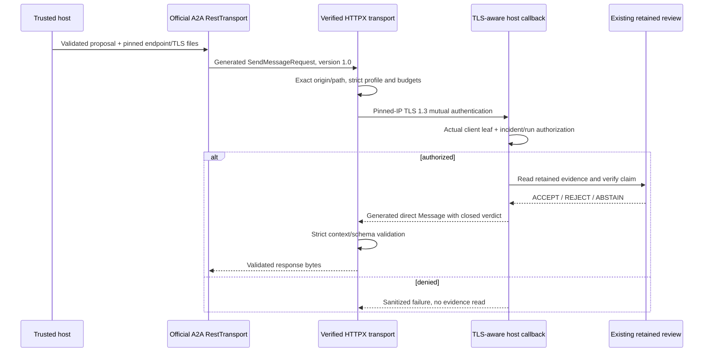

# A2A 1.0 retained-review profile v1

This contract defines a restricted stateless review profile, using the official SDK's generated protobuf messages and the existing closed proposal-v1/verdict-v1 JSON Schemas. It is not a production HTTP host or full task-service implementation. Install `.[a2a]`; the SDK is not a base dependency.

## Host-owned configuration

- `EgressPolicy`: approved hostname, port, literal address, server leaf fingerprint and exact `/message:send` path. Loopback requires explicit test opt-in.
- `TLSFiles`: host-selected CA, client certificate and private key; never supplied by a message or Agent Card.
- Receiving host: actual verified TLS socket, retained-run reader and immutable `AccessPolicy` for the client leaf/incident/run. A proxy header cannot substitute for the socket.

The client API is `await integration.a2a_client.review_a2a(encoded_proposal, endpoint=..., material=..., timeout=5.0)`. It returns the validated verdict dictionary. Invalid local proposal contracts reject before connecting. Other exchange failures are sanitized `ProtocolError`; cancellation propagates. Certificates and policy must be configured by the trusted host. The host callback `handle_send` accepts raw bounded bytes plus method/path/header tuples, validates the profile, then uses the existing authenticated review gate. No listener is started by either API.

## Wire contract

Use A2A 1.0 HTTP+JSON `POST /message:send`, exactly one `A2A-Version: 1.0` and `Content-Type: application/json`. No query, fragment, tenant prefix, token/forwarded identity, streaming or extension negotiation. Responses require JSON and bounded Content-Length under the existing secure-review transport. Version response headers may be absent; an advertised different/duplicate version rejects. Non-200 HTTP responses are sanitized failures; this callback does not implement a complete A2A production error responder.

The generated `SendMessageRequest` contains only:

- `message`: canonical UUID `messageId`, `contextId` equal to proposal incident_id, literal `ROLE_USER` and exactly one `parts` entry.
- Part: exactly `mediaType: application/json` and object `data` validated against `proposal-v1.json`.
- `configuration`: `acceptedOutputModes: [application/json]`; optional `historyLength` must be integer zero and `returnImmediately` must be false. No push config or other field.

`SendMessageResponse` contains only a direct `message`: fresh canonical UUID messageId, matching incident contextId, literal `ROLE_AGENT`, one JSON data part with the closed verdict-v1 object and matching run_id. ACCEPT, REJECT and ABSTAIN remain business outcomes. Rejected assessments/citations are not transport failures. Caller-supplied `taskId`, reference tasks, metadata, aliases, unknown fields, numeric role coercion, text, raw/file/URL parts and multiple parts reject. The SDK generated models perform normative field/type validation; the profile and business schemas further restrict them.

Raw UTF-8 JSON is limited to 16,384 bytes; duplicate keys and nonfinite values reject. The client additionally limits received headers plus body to 32,768 bytes and enforces one shared network deadline. Validation occurs before the SDK's lenient response decoder. There is one connection, no fallback/retry, and no mutation of evidence or queue databases. Message IDs identify individual consultations; they do not create durable remote jobs or deduplication records.

## Exchange and trust boundary

The host-generated Agent Card declares one `retained-review` skill, HTTP+JSON version 1.0 and `mutualTLS` security semantics through the generated mtls scheme. Streaming, push and extended-card capabilities are false. The card is descriptive metadata, not resource authorization or proof of identity. No public discovery route is shipped.

Production HTTP admission/framing and normative error responses, issuer/secrets operations, audit/rate/tenant controls and remote task lifecycle remain gates. See [ADR-0011](../adr/0011-official-a2a-stateless-review.md). This increment changes transport interoperability only: the Judge remains deterministic, with no LLM calls or calibrated model-accuracy result.
