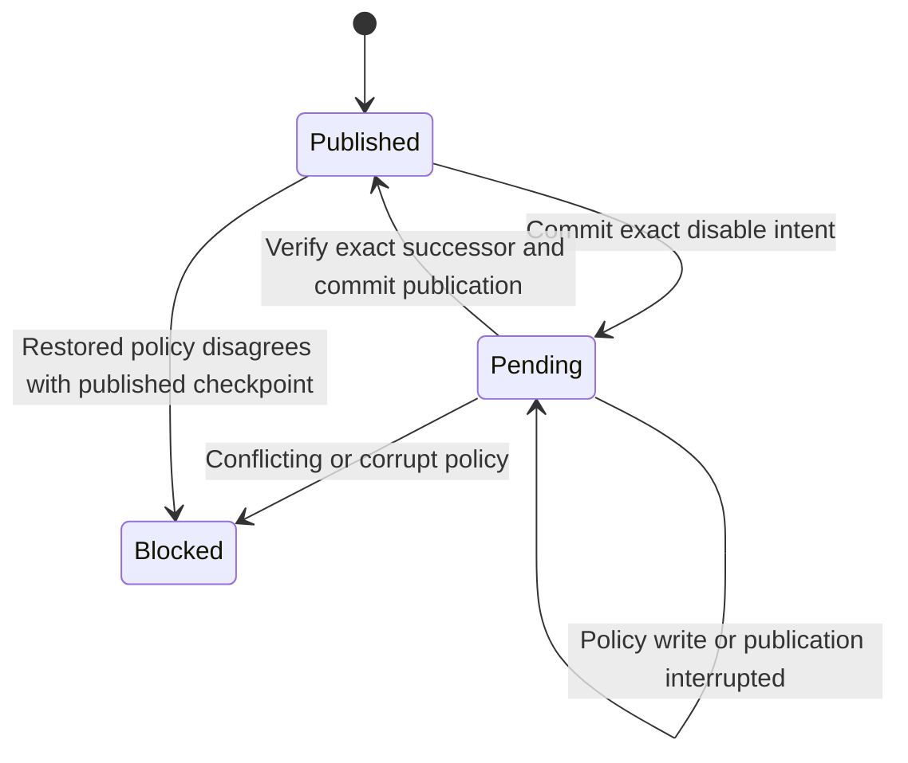

# Checkpoint publication and exact-intent recovery v1

`benchmark.checkpoint_control` supplies a local trusted-host publication coordinator above the shared key policy. A separate private SQLite control file retains the currently published checkpoint and either no pending work or one exact disable intent. The control file is authoritative; the policy database cannot nominate its own trusted checkpoint.

## API and state transitions

`initialize_checkpoint(control_path, policy_path, *, checkpoint)` first validates the supplied policy checkpoint, exclusively creates a mode-0600 control file, and returns the catalog digest. Both paths must be distinct. The host approves the initial checkpoint and configures the expected catalog digest externally. Existing files and symlinks are never overwritten.

`managed_disable(control_path, policy_path, *, catalog_sha256, key_id, now_ms)`:

1. Locks control, verifies its closed state and catalog binding, rejects pending work, and validates the current policy/catalog. Unknown keys fail before an intent is written. Already-disabled keys return the current checkpoint without another event.
2. Computes and commits the exact intent: key ID, host time and expected successor checkpoint. This commit happens before any policy mutation.
3. Runs recovery/publication to append or verify only that exact disable event, then atomically changes the control state to the successor and clears pending work.

`recover_checkpoint(control_path, policy_path, *, catalog_sha256)` explicitly resumes pending work. If policy already matches the intended successor, it verifies the chain and publishes it. Otherwise it may apply the recorded disable only to the exact previous checkpoint. A different successor, corrupted chain, older state or unexpected return remains blocked. Recovery with no pending intent only verifies the published checkpoint; it never adopts a database-discovered tip. Concurrent recovery calls serialize and produce one event.

`checkpoint_status(control_path, *, catalog_sha256)` returns host-only current/pending metadata. `evaluate_managed(control_path, policy_path, binding_path, registry_path, snapshot_path, *, catalog_sha256, resolve_key, **request)` denies all reads while an intent is pending, then passes only the published checkpoint to existing peer/key/grant/evidence validation. The request must not contain a caller-controlled checkpoint.

## Crash and concurrency semantics

The control transaction is released after recording intent and reacquired for policy mutation/publication. Any evaluation in that gap sees pending work and denies access. Recovery holds control across policy verification and mutation. A process exit after policy commit leaves durable pending work; the next explicit recovery verifies the stored successor rather than adding a duplicate event. Publication write failure rolls back the control transaction while preserving the previously committed intent.

All managed operations use lock order control → shared policy → identity binding → evaluator registry. The four paths must be distinct. A read already admitted may finish before a disable records intent; afterward pending work blocks new reads. The five-second SQLite lock timeout applies. Host callbacks must be bounded and must not reenter registries. Direct low-level mutations are not coordinated and can cause a deliberate fail-closed mismatch; use the managed entry points consistently.

## Ownership and operational boundary

The host must protect the control file separately from policy backups and untrusted inputs, using appropriate permissions and recovery procedures. Its catalog digest authenticates configuration scope, not every mutable checkpoint against a privileged owner. A path on the same filesystem is not an independent trust domain. Restoring both control and policy to old copies defeats rollback detection. The implementation supplies local serialized state and crash recovery, not a provisioned external monotonic service, hardware anti-rollback, distributed consensus, identity enrollment or KMS.

Control metadata contains no keys, labels, source data or exception text. Initialization failures can leave an empty reserved file. Unknown/corrupt/unreadable control cannot be silently replaced. Lifecycle audit remains in the shared policy; the control file holds current/pending state, not a separate append-only operator history. Deployment, restore custody and production identity/key operations remain explicit gates. Provider activation and measured model-quality requirements are unaffected.
