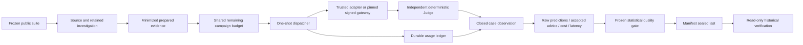

# Retained evaluation campaign v1

Profile: `public-synthetic-adapter-evaluation`. Public synthetic inputs only; no live activation permit.



## APIs and closed contracts

- `CampaignPolicy`: model ID/revision digest, aggregate token/cost maxima, case deadline and independent latency threshold. Bounds and exact integer types are enforced. The revision digest is host declared, not vendor attested.
- `run_campaign(directory, policy, build_adapter, clock_ms=..., clock_ns=...)`: requires a nonexistent directory. The factory receives `PreparedAdvisory` and `OperationBinding`, returns a matching `UsageQuote`/`Adapter`, and must not perform I/O during construction. It receives no label/split/family/case ID. Normal results include `manifest_sha256` and a recomputed `report`.
- `read_campaign(directory, manifest_sha256=...)`: requires a separately retained trusted digest; verifies every artifact and recomputes report fields. It never creates an adapter or sends requests. Missing/incomplete artifacts reject; callers preserve them for recovery review.
- `campaign-policy-v1.schema.json` and `campaign-observation-v1.schema.json` export the structural contracts. Runtime additionally requires exact integer accounting, exact case coverage/order, fixed public protocol and aggregate budget conservation.

Observation fields: `case_id`, fixed status, request/input digests, a closed advisory response or null, actual adapter invocation count, elapsed milliseconds, and charged/held tokens/cost. The external metadata ID is added by the evaluator after dispatch, never to the prepared prompt. Raw invalid output and exception messages are discarded. Response schemas contain only enumerations and digests.

Report fields include raw predictions, accepted predictions, independently recomputed quality counts/reasons, per-class/family statistics, operational reasons, aggregate charges/holds and max/total/nearest-rank p95 latency. Skipped cases are `NOT_RUN` with zero invocation/time/usage and remain `ERROR` in raw evaluation. Latency summaries include these zeros; inspect skipped-case reasons before interpreting p95. `live_activation_authorized` and `independent_model_accuracy_measured` are always false for this profile.

`PASS` for operations is separate from quality `BLOCK`. Neither command success nor valid signatures authorize production or establish high model accuracy. Thresholds come from the existing statistical protocol: they are not relaxed to make the small public fixture pass.

## Run and retain a local result

From an installed package:

```sh
RUN_DIR=$(mktemp -d)
python -m aegisflow_dr.benchmark.campaign_cli run-fixture "$RUN_DIR/campaign"
python -m aegisflow_dr.benchmark.campaign_cli read "$RUN_DIR/campaign" --manifest-sha256 <digest-returned-by-run>
```

Exit 0 means the command produced/read a valid report; inspect its independent decisions. Exit 1 is a sanitized execution/read failure. The fixture needs no API key and makes zero live model calls. Keep run directories and any credential/certificate materials outside the repository. Do not retry an interrupted campaign automatically; preserve completed observations and unresolved usage for operator review.

An ordinary successful fixture makes 18 adapter invocations, records 180 fixture tokens and 396 fixture nUSD, and has zero holds. These are deterministic test constants, not commercial billing or model-quality measurements. The independent quality decision must remain BLOCK.
