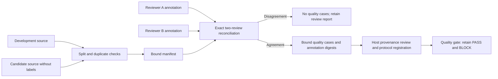

# Offline evaluation curation v1

Schemas: [label-free corpus](curation-corpus-v1.json), [manifest](curation-manifest-v1.json), [reviewer annotations](curation-annotation-v1.json).

1. The trusted host supplies separate development/candidate corpus bytes. Each case contains `case_id`, `family`, `group_id`, `csv_text` and `transform`. Never include labels, predictions, credentials or arbitrary metadata. Each JSON input is limited to 1 MB by the shared parser and arrays to 10,000 cases. Retain private input bytes for reproducibility.
2. `prepare_manifest` rejects known split leakage and repeated candidate groups/content, and returns canonical manifest bytes. Record its SHA-256 in the host-controlled preparation record. The manifest omits source CSV text and labels but contains identifiers and fingerprints, which can still be sensitive.
3. Two independently assigned reviewers annotate the candidate source separately. Each artifact binds its reviewer name and exact manifest digest and supplies one supported label per case. The host supplies the two approved reviewer names to `reconcile_annotations`; names are not authenticated identities.
4. A disagreement produces no exported labels. Preserve the report and seek independent adjudication; never silently choose a reviewer or take a majority of two. The current API has no adjudication override.
5. Agreement exports sorted `cases`, `quality_cases_sha256`, manifest digest and a reviewer-to-annotation-digest map. Canonicalize `cases` and retain the exact artifact bytes before calling `freeze_protocol`/`register_protocol`. The trusted host must separately approve independent labels, sealing, leakage and unsupported-claim review. Agreement does not set those flags.

This is local preparation tooling. It does not measure model accuracy or establish source rights, authenticated reviewers, true independence, semantic leakage detection, encrypted sealing, durable adjudication or deployment authorization. All examples and tests use synthetic fixtures.
