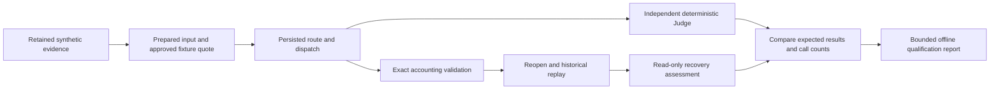

# Offline operational qualification v1

`aegisflow_dr.advisory.qualification.qualify_operations()` runs isolated synthetic stores and returns a JSON-compatible report. No input data, external services, credentials or deployment settings are accepted. All temporary stores are removed after the run. Any mismatch raises `AdvisoryError`; no partial PASS is returned.

After installing the wheel, run the repository's `tools/check_operational_installed.py` from outside the checkout. CI executes this check on Python 3.11, 3.12 and 3.14. The script rejects accidentally importing the source checkout and prints the qualification report.

| Scenario | Required terminal result | Adapter calls | Held tokens | Charged tokens | Charged nUSD |
|---|---|---:|---:|---:|---:|
| Settled retryable failure then fallback | VERIFIED_ADVISORY | 2 | 0 | 12 | 26 |
| Ambiguous provider outcome | USAGE_UNKNOWN | 1 | 15 | 0 | 0 |
| Known terminal failure | KNOWN_TERMINAL_FAILURE | 1 | 0 | 2 | 4 |
| Invalid structured response | RESPONSE_REJECTED | 1 | 0 | 10 | 22 |
| Unsupported claim | REJECTED_ADVISORY | 1 | 0 | 10 | 22 |
| Original deadline expired | DEADLINE_EXCEEDED | 0 | 0 | 0 | 0 |
| Cost insufficient for next full reservation | ADMISSION_DENIED | 1 | 0 | 2 | 4 |

Each completed scenario reopens the actual ledger, replays without another adapter invocation, checks exact accounting and confirms recovery assessment is read-only. UNKNOWN retains 35 nUSD and accepts only a snapshot-bound advisory review packet. A separate interrupted-worker scenario persists IN_FLIGHT, reopens, retains 15 tokens / 35 nUSD, reports running/unresolved reasons and rejects automatic route resumption. Original evidence bytes remain unchanged.

The report includes `version`, `profile`, `status`, scenario outcomes/counts, `interrupted_worker`, `evidence_unchanged`, `live_provider_calls: 0`, `live_activation_authorized: false` and an explicit list of unverified live boundaries. It excludes prompts, source rows, credentials, owner tokens and operator identities. Its reproducibility is checked across fresh runs. Tests inject incorrect accounting and unexpected resumption to ensure the suite cannot falsely return PASS.

Remaining boundaries: authenticated provider usage receipts; full tokenizer/framing/cache/reasoning/tool billing; transport-level cancellation and deadlines; independently measured model quality; deployed identity, custody, isolation and recovery. This fixed synthetic qualification is a regression gate, not a performance benchmark, live readiness certificate or model accuracy measurement.
