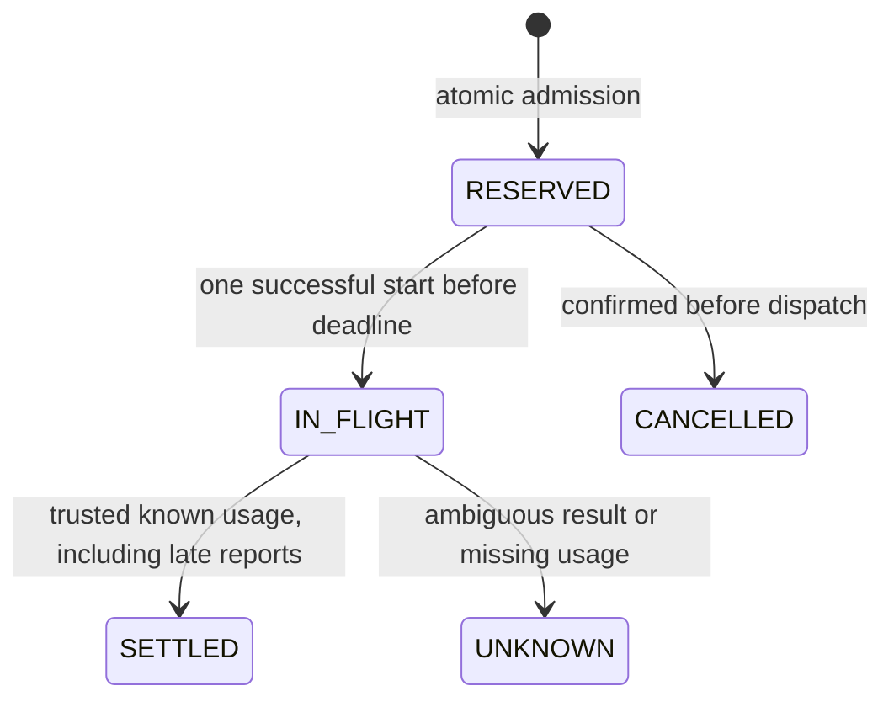

# Usage ledger v1 — Trusted local Python contract

Module: `aegisflow_dr.advisory.usage`. This is an internal host API with typed immutable dataclasses, not a network JSON endpoint. No wire schema or public authorization boundary is introduced.

## Initialization and inputs

- `initialize_usage(path, UsagePolicy(...))` accepts an empty separate database only. Existing evidence or usage databases are rejected without migration. `UsageLedger(path, clock_ms=...)` opens an existing initialized database. Each database defines one explicit lifetime budget scope; existing paths are never silently recreated.
- `UsagePolicy`: max_tokens integer 1..1e9; max_cost_nusd integer 0..1e18; max_attempts integer 1..8 **per prepared request**; max_duration_ms integer 1..600000. Booleans, floats and coercible strings are rejected. Defaults: 100000 tokens, 1 USD, two attempts, ten seconds.
- `UsageQuote`: full prepared input SHA-256, matching model_id, adapter_id revision, input_tokens and output_limit each integer 1..1e6; input_rate_nusd and output_rate_nusd each integer 0..1e9. One USD is 1e9 nUSD. Zero-priced tokens still consume token budget. Identity fields are bounded allowlisted strings, never credentials. The adapter revision must identify tokenizer, pricing and provider framing assumptions; no tokenization or price discovery occurs here.
- `reserve(prepared, quote, attempt_key=..., deadline_ms=...)`: exact PreparedAdvisory/UsageQuote objects; key is 1..64 ASCII letters/digits/underscore/hyphen, stored as SHA-256. Deadline is an integer absolute UTC epoch millisecond value, greater than current time and at most current time plus policy duration. Retries must reuse the first deadline. The injectable clock is trusted test/host infrastructure, not request input.

Reserved tokens = input_tokens + output_limit. Reserved cost = input_tokens × input_rate_nusd + output_limit × output_rate_nusd. Admission requires both held + charged + new reservation totals to fit. Full quote digest, prepared input digest and request digest are retained. No prompt, source values, output text, API key, certificate or raw idempotency key is stored.

## Lifecycle



`transition(attempt_id, action, input_tokens=None, output_tokens=None)` supports start, cancel, settle, unknown. Start is never idempotently reauthorized. Cancel/unknown are repeatable in their exact terminal state. Settle is repeatable only with identical actual input/output usage. Conflicting settlements, unknown attempts and illegal transitions fail with AdvisoryError. SQLite/filesystem failures produce a fixed sanitized error without paths or database details.

Settlement accepts integer input/output counts from zero to the reserved caps and charges their exact per-token cost. It releases the unused reservation regardless of whether the separate Judge accepts the response. Over-cap/invalid reports do not release holds. Usage comes from a trusted adapter, never generated JSON. A model/transport failure with certain zero usage may settle zero; a timeout alone is insufficient evidence of zero usage.

UNKNOWN and crash-left IN_FLIGHT retain full holds and block another attempt for that request. No automatic expiry refund or UNKNOWN reconciliation exists. The separate routing controller described below can schedule bounded trusted adapter calls. RESERVED expiry blocks start and retains its hold until explicit pre-dispatch cancellation. An idempotent reserve after settlement returns the recorded terminal receipt, not new dispatch permission. Attempts include cancellations and are never reset for that request.

`snapshot()` returns version, detached policy, held/charged tokens and cost, and total attempt count. It does not expose source/prompt data. Database rows and digests remain sensitive operational metadata; protect filesystem permissions and storage according to host policy. This library supplies no encryption, tenant authentication, ledger tamper attestation or backup/retention operations. Snapshot reads take a short database lock for consistency.

## Integration sequence

```mermaid
sequenceDiagram
  participant H as Trusted host
  participant P as PreparedAdvisory
  participant L as UsageLedger
  participant A as Future approved adapter
  participant J as Existing deterministic Judge
  H->>P: Verify evidence and prepare immutable prompt
  H->>L: Reserve exact input with host quote and deadline
  H->>L: Start attempt once
  Note over H,A: Local dispatch is implemented; live provider activation remains gated
  H-->>A: Exact prepared snapshot, remaining time, output cap
  A-->>H: Trusted usage and untrusted structured response
  H->>L: Settle known usage or retain UNKNOWN hold
  H->>J: Independently verify response and current evidence
```

An adapter must bind tokenization to the final provider payload, conservatively include provider framing/reasoning/cache/tool charges, cap output and use the remaining transport deadline. A quote alone does not prove actual provider billing or stop out-of-band calls. Current tests use explicit fixture token counts/rates with zero model calls. Local retry/backoff and bound shared-operation routing are now implemented; provider-specific accounting and sealed quality evaluation remain gates.

## Optional dedicated-operation guard

UsagePolicy.max_total_attempts defaults to None for legacy behavior. An explicit integer 1..100000 enables a shared total-attempt cap, original deadline and unresolved-attempt guard across all requests/models in that dedicated ledger. Cancelled/zero-use attempts count. No stored JSON rewrite occurs for legacy metadata; no schema migration occurs. Host operation identity and model eligibility remain prerequisites for automatic fallback. See [ADR-0020](../adr/0020-shared-operation-budget-foundation.md).

## Optional bound operation ledgers

New operation-bound scopes use metadata version 2 and an immutable [operation binding](operation-binding-v1.md). Version 1 databases remain unmodified; there is no implicit migration. Shared guards still apply, and eligibility is checked before receipt lookup. Version 2 initialization requires a total attempt cap and opening requires the operation UUID.

## Optional exclusive routing profile

`initialize_usage(..., operation=binding, routing=True)` creates a version 3 ledger with route and event tables. Direct reservations require the owner token and exact next candidate from the durable plan. Version/table mismatch fails closed. No migration of version 1/2 ledgers occurs. See the [routing contract](model-routing-v1.md).


## Persisted accounting checks (increment 40)

Every handle open, snapshot, reservation, transition, route journal operation and recovery assessment validates the stored accounting before using it. Exact integer reservation/settlement arithmetic, state/actual-use consistency, digest/model fields, per-request/shared limits, allowed model/original deadline and aggregate budgets are checked. An open handle rejects changed policy/version/operation metadata. Legacy policy bytes remain unchanged. An internally inconsistent database is rejected, never automatically repaired or refunded.

All profiles now cap retained attempts at 100,000; cancelled attempts count. Reads and arithmetic validation are bounded and linear in scope size. Rotate scopes only through an explicit host budget policy; the library never resets budgets or deletes history automatically. These consistency checks do not authenticate a hostile host, prove provider billing or detect a coordinated consistent rollback. See [ADR-0040](../adr/0040-operational-qualification-and-accounting-integrity.md) and the [operational qualification suite](operational-qualification-v1.md).
